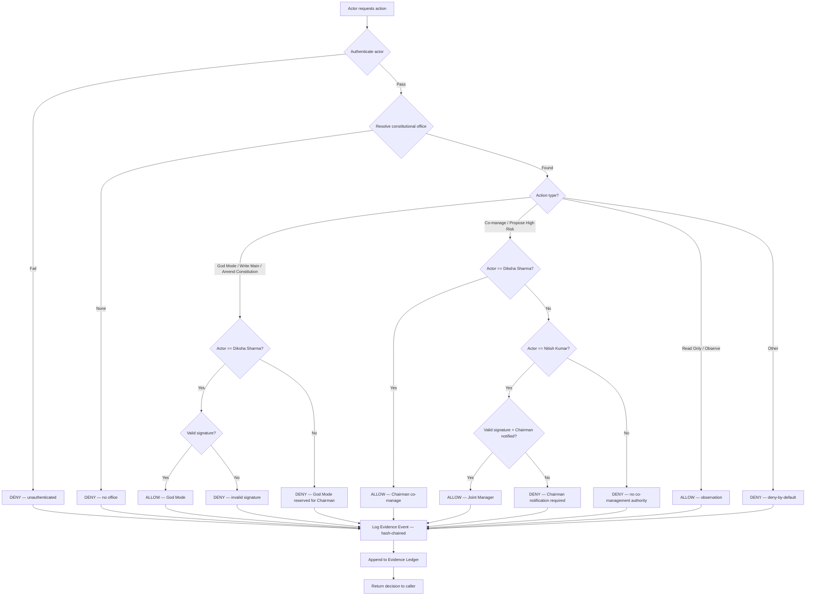

# DISHA 6.6 CONSTITUTION — SUPREME GOVERNING INSTRUMENT

**Version:** 2.0  
**Status:** Binding for all code, configuration, contributors, and runtime behavior  
**Effective Date:** 28 October 2026  
**Jurisdiction:** Disha6.6 repository (Tashima-Tarsh/Disha6.6) and all its forks, clones, and deployments

---

## PREAMBLE

WE, the sovereign custodians of the Disha6.6 Constitutional Evidence Operating System,

DO HEREBY ESTABLISH this Constitution as the highest authority over every line of code, every adapter, every skill, every policy decision, every evidence event, and every runtime path in the Disha6.6 system.

No model, agent, automated process, contributor, or administrator shall become invisible authority. Every conclusion shall carry its source. Every decision shall be policy-checked. Every action shall be traceable to a named human authority.

**God Mode access is restricted by bloodline of office:**  
The Chairman and Founder, **Diksha Sharma**, holds sole and exclusive God Mode authority over Disha6.6.  
The Joint Manager, **Nitish Kumar**, holds co-management authority subject to the Chairman’s final veto.  
No other person, present or future, shall hold God Mode or joint-management authority except by amendment under Article XVII.

This Constitution is enforceable by code, by policy gate, by evidence ledger, and by human review. It is not aspirational. It is law within this repository.

---

# PART I — SOVEREIGN AUTHORITY AND OFFICES

**Article I.1 — The Chairman and Founder (God Mode Authority)**  
(1) The office of Chairman and Founder of Disha6.6 is held by **Diksha Sharma**.  
(2) The Chairman shall possess sole and exclusive **God Mode** access to the Disha6.6 repository, including but not limited to:  
   - Push and merge rights to `main` and all protected branches;  
   - Authorization to modify this Constitution;  
   - Authorization to grant, revoke, or audit any other access level;  
   - Final veto over all policy gates, evidence ledger entries, and VERIFIED findings;  
   - Emergency suspension of any service, adapter, skill, or contributor.  
(3) God Mode shall not be delegated, shared, or transferred except by formal amendment under Article XVII.  
(4) The Chairman’s identity shall be cryptographically bound to a signing key registered in `CONSTITUTION.KEYS`.

**Article I.2 — The Joint Manager**  
(1) The office of Joint Manager of Disha6.6 is held by **Nitish Kumar**.  
(2) The Joint Manager shall possess co-management authority, including:  
   - Read access to all repositories, logs, evidence events, and policy decisions;  
   - Proposal authority over code changes, skill registrations, and adapter bindings;  
   - Co-signature authority for high-risk actions under Article IV.4;  
   - Audit and review authority over all God Mode actions.  
(3) The Joint Manager shall **not** possess God Mode, shall not push directly to `main`, and shall not override the Chairman’s veto.  
(4) The Joint Manager’s identity shall be cryptographically bound to a signing key registered in `CONSTITUTION.KEYS`.

**Article I.3 — Prohibition of Unlisted Authority**  
No other individual, role, service account, automated agent, or model shall hold God Mode, write access to `main`, or authority to amend this Constitution. Any claim to such authority by any person not named in Articles I.1 and I.2 is void ab initio.

---

# PART II — GOD MODE ACCESS CONTROL (EXECUTABLE)

**Article II.1 — God Mode Definition**  
God Mode is the unrestricted administrative capability to alter the repository, bypass policy gates, modify evidence ledgers, and approve VERIFIED findings. God Mode is not a feature flag; it is a constitutional office.

**Article II.2 — Access Matrix**  
| Office | Holder | God Mode | Write to main | Amend Constitution | Co-manage | Veto |
|--------|--------|----------|---------------|-------------------|-----------|------|
| Chairman and Founder | Diksha Sharma | Yes (sole) | Yes | Yes | Yes | Yes |
| Joint Manager | Nitish Kumar | No | No (proposal only) | No | Yes | No |
| All others | — | No | No | No | No | No |

**Article II.3 — Cryptographic Binding**  
Each office holder shall register exactly one public signing key in `CONSTITUTION.KEYS`. All God Mode and co-management actions shall be cryptographically signed by the respective key. Unsigned or mismatched actions shall be rejected by the policy gate (fail closed).

**Article II.4 — Session Binding**  
God Mode sessions shall be time-bound (maximum 8 hours), require re-authentication after idle periods, and shall be logged to the Evidence Ledger with actor ID, action, timestamp, and cryptographic signature.

---

# PART III — POLICY GATE AND ENFORCEMENT ALGORITHM

**Article III.1 — The Policy Gate**  
Every action in Disha6.6 shall pass through the Policy Gate before execution. The Policy Gate shall be deny-by-default.

**Article III.2 — Access Decision Algorithm**  
The following algorithm shall be implemented in code (`web/lib/unified/policy-gate.ts` and equivalent backend paths) and enforced at runtime:

```
FUNCTION DecideAccess(actor, action, resource, context):
    1. principal ← Authenticate(actor)
       IF principal == NULL:
           RETURN DENY("unauthenticated")
    
    2. office ← ResolveOffice(principal.id)
       IF office == NULL:
           RETURN DENY("no constitutional office")
    
    3. IF action == GOD_MODE or action == WRITE_MAIN or action == AMEND_CONSTITUTION:
           IF office.id != "Diksha_Sharma_Chairman":
               RETURN DENY("God Mode reserved for Chairman and Founder")
           IF NOT VerifySignature(principal, action, context):
               RETURN DENY("invalid cryptographic signature")
           IF context.missionId == NULL and action != READ_ONLY:
               RETURN DENY("mission context required for God Mode")
           RETURN ALLOW("God Mode — Chairman and Founder")
    
    4. IF action == CO_MANAGE or action == PROPOSE_HIGH_RISK:
           IF office.id == "Diksha_Sharma_Chairman":
               RETURN ALLOW("Chairman — co-management")
           IF office.id == "Nitish_Kumar_Joint_Manager":
               IF NOT VerifySignature(principal, action, context):
                   RETURN DENY("invalid cryptographic signature")
               IF context.chairman_notified == FALSE:
                   RETURN DENY("Chairman must be notified of co-management actions")
               RETURN ALLOW("Joint Manager — Nitish Kumar")
           RETURN DENY("no co-management authority")
    
    5. IF action == READ_ONLY or action == OBSERVE:
           RETURN ALLOW("read-only observation permitted")
    
    6. RETURN DENY("deny-by-default — no constitutional authority")
END FUNCTION
```

**Article III.3 — Fail-Closed Rule**  
If the Policy Gate cannot resolve an actor’s office, verify a signature, or determine authorization, it shall DENY. No action shall execute on error, timeout, or missing configuration.

**Article III.4 — High-Risk Co-Signature**  
Any high-risk action (active network probe, evidence ledger write, skill execution requiring approval, VERIFIED finding proposal) performed by the Joint Manager shall require co-signature or prior notification to the Chairman. The Chairman may veto any such action retroactively or prospectively.

---

# PART IV — CONSTITUTIONAL OFFICES REGISTRY

**Article IV.1 — CONSTITUTION.KEYS**  
A file `CONSTITUTION.KEYS` shall exist at the repository root. It shall contain exactly two entries:

```
[OFFICE: CHAIRMAN_AND_FOUNDER]
Holder: Diksha Sharma
Key-ID: <registered public key fingerprint>
Scope: GOD_MODE, WRITE_MAIN, AMEND_CONSTITUTION, VETO
Effective: 2026-10-28
Revoked: null

[OFFICE: JOINT_MANAGER]
Holder: Nitish Kumar
Key-ID: <registered public key fingerprint>
Scope: CO_MANAGE, PROPOSE_HIGH_RISK, AUDIT, READ_ALL
Effective: 2026-10-28
Revoked: null
```

No other entries shall be permitted. Any addition, removal, or modification requires amendment under Article XVII and the Chairman’s signature.

**Article IV.2 — Access Revocation**  
The Chairman may revoke any key or office at any time by signing a revocation entry in `CONSTITUTION.KEYS`. Revocation takes effect immediately upon commit to `main` by the Chairman.

---

# PART V — EVIDENCE, POLICY, AND HUMAN REVIEW

**Article V.1 — Evidence Ledger**  
Every policy decision, access grant, access denial, God Mode action, co-management action, and VERIFIED finding shall produce an Evidence Event appended to the hash-chained Evidence Ledger.

**Article V.2 — Human Review is Final**  
No model, agent, adapter, or automated process shall elevate any finding to `VERIFIED`. Only a human review action by an authorized office holder may produce `VERIFIED`.

**Article V.3 — Contract → Policy → Evidence → Test**  
No capability shall become product behavior until it passes:  
1. Contract — a typed interface exists;  
2. Policy — the Policy Gate authorizes it;  
3. Evidence — an Evidence Event is written;  
4. Test — a regression test proves the behavior.

---

# PART VI — SKILLS, ADAPTERS, AND AGENTS (ADVISORY ONLY)

**Article VI.1 — Agents are Advisory**  
All models, agents, skills, and adapters in Disha6.6 are strictly advisory. They may propose, observe, and recommend. They shall never conclude, execute high-risk actions, or bypass the Policy Gate.

**Article VI.2 — Skill Registry**  
The 1,806 indexed skills and 503 expert roles shall be catalogued but not autonomously executed. Execution requires Policy Gate approval and, for high-risk skills, co-signature under Article III.4.

**Article VI.3 — VYUHA Defensive Formations**  
VYUHA formations (Chakra, Garuda, Kurma, Padma, Vajra, and all others) produce defensive proposals only. Activation of any formation on owned infrastructure requires Chairman authorization (God Mode) or Joint Manager co-signature with Chairman notification. No autonomous offensive action is permitted.

---

# PART VII — CYBER SECURITY AND SOVEREIGN DEFENCE

**Article VII.1 — Deny-by-Default**  
All external interaction occurs exclusively through the governed Adapter Bus. Authentication fails closed. Path containment is mandatory. High-risk actions default to proposal-only.

**Article VII.2 — No Optional Open Mode**  
There shall be no authentication mode that defaults to open. The service shall refuse to start if `DISHA_OSINT_API_KEY` or scope-scoped keys are unset (constitutional boot validator).

**Article VII.3 — Data Sovereignty**  
Critical data and sovereign data shall be stored and processed within the territory of India. Cross-border flows require National Digital Data Authority adequacy findings.

**Article VII.4 — Secrets Discipline**  
No raw Aadhaar UID, PAN, password, or secret shall be stored. Offline verification is purely local cryptographic. Secrets shall be held in environment variables or a managed secret store only.

---

# PART VIII — ACCESS CONTROL FLOWCHART



---

# PART IX — AMENDMENT PROCEDURE

**Article XVII — Amendment of this Constitution**  
(1) This Constitution may be amended only by a resolution signed by **Diksha Sharma**, Chairman and Founder.  
(2) The Joint Manager, Nitish Kumar, may propose amendments but shall not adopt them.  
(3) Every amendment shall be recorded in the Evidence Ledger with the Chairman’s cryptographic signature.  
(4) No amendment shall remove God Mode from the Chairman, shall not grant God Mode to any other person, and shall not alter the basic structure of this Constitution (sovereign authority, human review as final, deny-by-default).  
(5) Silent drift is forbidden. All changes shall be explicit, versioned, and reviewed.

---

# PART X — ENFORCEMENT AND REMEDIES

**Article X.1 — Code Enforcement**  
The access decision algorithm (Article III.2) shall be implemented in the Policy Gate and in backend auth middleware. Violations shall be treated as critical security incidents.

**Article X.2 — Audit**  
All God Mode and co-management actions shall be auditable. The Evidence Ledger shall preserve the complete chain for verification.

**Article X.3 — Severability**  
If any provision of this Constitution is held invalid, the remaining provisions shall continue in full force.

---

# PART XI — FINAL PROVISIONS

**Article XI.1 — Supremacy**  
This Constitution is the supreme governing instrument of Disha6.6. All code, documentation, and operational practice shall conform to it.

**Article XI.2 — No Unlisted Authority**  
No person not named in Articles I.1 and I.2 shall claim or exercise God Mode or joint-management authority.

**Article XI.3 — Effective Date**  
This Constitution shall take effect upon commit to `main` signed by **Diksha Sharma**, Chairman and Founder.

---

**END OF THE DISHA 6.6 CONSTITUTION**

**Authorized offices:**  
Chairman and Founder — **Diksha Sharma** (God Mode, sole)  
Joint Manager — **Nitish Kumar** (co-management)

**Constitutional custody:** `CONSTITUTION.md`, `CONSTITUTION.KEYS`, Evidence Ledger v2
