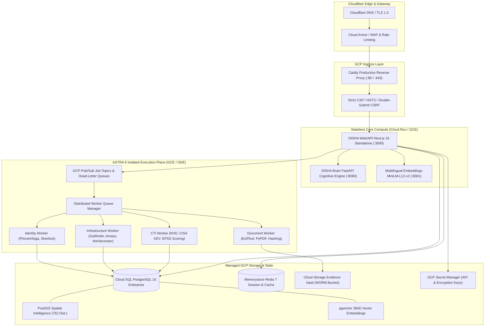

# DISHA 6.6
### Constitutional Evidence Operating System & Sovereign Defense Intelligence Platform

[](https://github.com/Tashima-Tarsh/Disha6.6/actions/workflows/ci.yml)
[](https://github.com/Tashima-Tarsh/Disha6.6/actions/workflows/db-migrations.yml)
[](https://cloud.google.com)
[-000000?logo=nextdotjs&logoColor=white)](https://nextjs.org)
[](https://www.postgresql.org)
[](https://threejs.org)
[-red)](https://github.com/Tashima-Tarsh/Disha6.6)

---

## Executive Overview

**DISHA 6.6** (Defense Intelligence & Sovereign Homeland Analytics) is an enterprise-grade cognitive defense operating system engineered for national security analysts, cyber-defense operators, and sovereign command authorities.

DISHA operates as **one unified intelligence operating system**:
* **Public OSINT & Infrastructure Reconnaissance:** Authoritative multi-source intelligence gathering across passive DNS, RDAP, Certificate Transparency, and public repositories.
* **Cyber Threat Intelligence (CTI) & Attack Surface Defense:** Dynamic attack surface asset mapping, technology fingerprinting, CVE-to-CISA-KEV exploit correlation, and look-alike domain protection.
* **Constitutional Contradiction & Corroboration Engine:** Automated detection of statement vs. statement conflicts, gazette-to-action discrepancies, and independent source family validation.
* **Astra 6 3D Spatial Gateway:** Full-screen WebGL three-dimensional spatial identity command surface anchoring national defense hubs across India.
* **Zero-Mock Policy & Cryptographic Provenance:** Every displayed indicator, entity node, geospatial district, and observation is anchored in a tamper-evident SHA-256 Merkle-chained evidence ledger.

```
OPERATIONAL DATA CHAIN:
Public Sensor Intercept ──► Universal Target Classifier ──► Constitutional Policy Gate ──► Distributed Worker Bus ──► SHA-256 Evidence Vault ──► Command Review
```

---

## 3D Spatial Gateway & Visual Architecture

The **Astra 6 Sovereign Cyber Matrix** provides an immersive, full-screen `100vw × 100dvh` WebGL spatial command visualization:

```
                                  ▲ NORTH (Ladakh / Siachen / Kashmir)
                                  │
                  [Srinagar Cyber Node]
                           │
       [Western Energy]    │
       (Ahmedabad) ────────┼──────── [NEW DELHI ROOT VAULT] (28.6139° N, 77.2090° E)
                           │                   │
         [Mumbai Subsea] ──┴── [Hyderabad CTI] └── [Kolkata Eastern Node]
         (Subsea Core)                 │                     │
                  │             [Bengaluru Aerospace] ────── [Guwahati Matrix]
                  │                    │
                  └── [Chennai Landing]│
                               │       │
                        [Kochi Node] ──┴── [Kanyakumari Apex]
                                                  │
                                          [Port Blair Array]
```

### Dynamic 5-Color Telemetry Stream
* 🟠 **Saffron (`#FF6600`):** Sovereign Command Authority, Gazette Verification, and National Root Defense.
* ⚪ **White (`#FFFFFF`):** Constitutional Policy Gates, Judicial Precedent, and Integrity Ledgers.
* 🟢 **Green (`#00E676`):** PostGIS Spatial Geometry, Resilient Infrastructure, and Civil Coordination.
* 🔵 **Navy (`#0077FF`):** Passive Network Intercepts, DNS Resolution, and Certificate Transparency Streams.
* 🟡 **Gold (`#FFD700`):** Cryptographic Provenance Proofs, Merkle Roots, and Non-Repudiation Vault Artifacts.

---

## GCP Production Architecture

DISHA 6.6 is deployed on a decoupled, high-resilience Google Cloud Platform infrastructure in the `asia-south1` (Mumbai) region:



---

## 10 Integrated Operational Surfaces

| Surface | Route | Operational Function |
| :--- | :--- | :--- |
| **Astra 6 Spatial Login** | `/login` | Full-screen 3D WebGL sovereign gateway, biometric OIDC (Meri Pehchan, Intra ID), signed sessions. |
| **Mission Command** | `/` | Central intelligence workbench, operational lenses, mission planner, live telemetry streams. |
| **Cyber Defense Engine** | `/cyber-defense` | Attack surface nodes, technology fingerprinting, CVE-to-CISA-KEV correlation, look-alike domain defense. |
| **Contradiction Center** | `/contradictions` | Statement vs statement conflicts, gazette vs action divergence, temporal anomalies, review gates. |
| **Corroboration Engine** | `/corroboration` | Multi-source clustering, source family independence breakdown, anti-syndication ratios. |
| **Evidence Vault** | `/vault` | Cryptographic evidence repository, SHA-256 content-addressable storage, document diffing. |
| **Public Surveillance** | `/surveillance` | Real-time public sensor feeds: Google DNS-over-HTTPS, crt.sh Certificate Transparency, RDAP. |
| **Spatial Intelligence** | `/geospatial` | PostGIS-grounded 762 district boundaries, defense installations, subsea landing clusters. |
| **Cognitive Graph** | `/graph` | Constitutional entity resolution, relationship lineage, Merkle provenance visualization. |
| **Governance Ledger** | `/governance` | Cryptographic audit trail, policy decision history, non-repudiation verification. |

---

## ASTRA 6 CLI Execution Plane

To ensure maximum security and stability, CLI-heavy tools are executed outside the Next.js process boundary in dedicated, hardened worker containers:

* **Identity OSINT Worker:** `PhoneInfoga` (v2.11.0), `Sherlock` (v0.15.0) — gated behind explicit operator policy approval.
* **Infrastructure OSINT Worker:** `ProjectDiscovery Subfinder` (v2.6.6), `OWASP Amass` (v4.2.0 passive), `theHarvester` (v4.6.0 passive).
* **Document Intelligence Worker:** `ExifTool` (v12.76), `PyPDF`, SHA-256 / SHA-512 cryptographic hashing.
* **Cyber Threat Intelligence Worker:** MITRE CVE, CISA KEV (Known Exploited Vulnerabilities), FIRST EPSS scoring models.

### Execution Security Directives
* Every worker executes under **least-privilege non-root** service accounts (`uid 10001`).
* **Zero shell command concatenation:** All processes invoked via `execFile(binary, args[])` with strict regex argument guards.
* Read-only container root filesystems with ephemeral memory-backed `/tmp`.
* Automatic lease renewal, heartbeat monitoring, and dead-letter queue escalation.

---

## Production Verification & Quality Gates

The codebase strictly enforces automated quality and security gates:
* **Zero-Mock Policy:** Zero mock data in production adapters, databases, and mission runners.
* **Console Logging Policy:** `console.info()` strictly enforced across all components; `console.log()` banned.
* **Zero-Debt Policy:** Zero `TODO`, `FIXME`, `HACK`, `@ts-ignore`, or `eslint-disable` annotations permitted in merged branches.
* **Non-Repudiation Rule:** AI agents are cryptographically prohibited from assigning a `VERIFIED` state to any evidence or claim. Human operator review is strictly mandatory.

---

## License & Sovereign Notice

DISHA 6.6 is engineered under strict Constitutional No-First-Use (NFU) defensive doctrines. All modules adhere to sovereign security controls and statutory data preservation directives.
