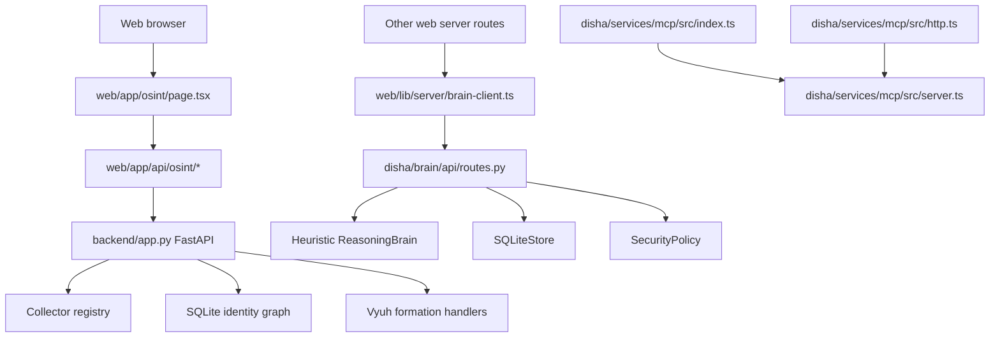

# DISHA 6.6 — Evidence-oriented intelligence platform (source-grounded overview)

> **Documentation status (23 October 2026):** This README is a source-evidenced architectural orientation, **not** an attestation that every feature is active, safe, or production-ready. The repository contains 5,757 tracked blobs; the associated audit inspected a defined sample of 34 source/configuration files, not the entire codebase. See [coverage](docs/repository-coverage.md) and [findings](docs/technical-audit.md). No application code was modified.

DISHA 6.6 is a multi-surface repository with a **Next.js web application**, an independent **Python FastAPI brain service**, a separate **FastAPI OSINT service**, TypeScript/Python AI-related modules, MCP server implementations, integration collections, evidence-oriented components, and legacy code. These are **separate entry points and codebases**; being present does not establish that every feature is connected to the main product or deployed. This overview is based on source, manifests, and directory evidence rather than product claims.

## Contents

- [System at a glance](#system-at-a-glance)
- [Source-evidenced architecture](#source-evidenced-architecture)
- [Applications and units](#applications-and-units)
- [Technology](#technology)
- [Execution and data boundaries](#execution-and-data-boundaries)
- [Status and limitations](#status-and-limitations)
- [Security considerations](#security-considerations)
- [Documentation index](#documentation-index)

## System at a glance

| Area | Evidence | Verified characterization |
| --- | --- | --- |
| Web application | `web/package.json`, `web/app/route.ts` | Next.js 16.3.6 / React 19.3 web surface; root request redirects according to session token |
| OSINT UI | `web/app/osint/page.tsx` | Client-side page requests scan, graph resolution, ingestion, and formations through Next.js API proxies |
| Standalone OSINT backend | `backend/app.py` | FastAPI collector registry, server-sent scan stream, SQLite-backed identifier graph, CSV ingestion |
| Brain API | `disha/brain/app.py`, `disha/brain/api/routes.py` | Separate FastAPI API, event-bus alerts, guarded command/graph/cache/memory endpoints |
| Brain reasoning | `disha/brain/brain/reasoning.py` | **Heuristic planner**, not verified LLM inference |
| Browser-side agent workflow backend | `web/lib/server/agent/workflow.ts` | Defines chat/http/sleep/set workflow nodes; reachable callers need separate verification |
| MCP Explorer | `disha/services/mcp/src/server.ts`, `src/index.ts`, `src/http.ts` | MCP tools/resources/prompts with stdio and SSE entry points; HTTP `/mcp` explicitly returns 501 |
| Root MCP entry point | `src/entrypoints/mcp.ts` | Separate implementation with unresolved import references in the tracked root `src/` tree |
| Integration and legacy collections | `disha/services/integrations/`, `disha/legacy-root-src/` | Large source collections; runtime registration and ownership unverified |

### Repository census

GitHub tree `4b7caad2612199a0870bc7b60396d93fc307f38a` (main, sampled 23 October 2026): **7,550 entries**, including **5,757 files** and **1,775 tree entries**. File counts by major first path: `disha/` 4,015, `web/` 744, `.agents/` 467, `legacy/` 161, `docs/` 141, `skills/` 56, `scripts/` 44. These are **file counts, not deployed features, live tools, or security findings**.

## Source-evidenced architecture

**Graph scope:** The arrows above reflect imports, route forwarding, or function calls visible in inspected files. They do not establish deployment connectivity, comprehensive registration, or live API availability. See [architecture overview](docs/architecture-overview.md), [graph](docs/architecture-graph.json), and the [offline interactive architecture viewer](docs/architecture-3d.html).

## Applications and units

### Web frontend and backend

- `web/app/`: Next.js App Router pages and routes; `web/app/route.ts` checks an access token and redirects to `/investigate` or `/login`.
- `web/app/osint/page.tsx`: a client-side OSINT UI with a stream reader and graph/formation actions. Its proxies under `web/app/api/osint/` forward requests to the separate Python service.
- `web/lib/server/`: server utilities including authentication, environment, database, policy, Brain client, workflows, and OSINT MCP adapter.
- `web/lib/unified/`, `web/lib/extensions/`, `web/database/`: tracked source and migrations; individual implementation status requires per-file audit.

### Python services and AI

- `backend/app.py`: standalone OSINT service; collector registration is code-defined. Its scan endpoint streams results; its local SQLite graph is separate from the Brain store.
- `disha/brain/api/routes.py`: constructs `AppContext` and registers API routes, including token-required routes for commands, graph, cache, and telemetry.
- `disha/brain/brain/`: individual planning, anomaly, decision, reasoning, executor and risk modules; their names must not be read as proof of real model-backed intelligence.
- `disha/ai/`: AI-model, RAG, physics, simulation, and strategy source trees. Integration into the active request path remains unverified.

### MCP and integrations

- `disha/services/mcp/src/server.ts`: registers MCP tool, resource, and prompt handlers.
- `disha/services/mcp/src/index.ts`: stdio entry point; `http.ts`: SSE HTTP entry point. The exposed `/mcp` route is a 501 placeholder.
- `src/entrypoints/mcp.ts`: a distinct root MCP source file with apparent missing local imports; see audit.
- `disha/services/integrations/` and `.agents/skills/` are sizeable tracked collections. Directory presence alone is not evidence of activation.

## Technology

Verified from tracked manifests/source: **TypeScript**, **Node.js 22 target**, **Next.js 16.3.6**, **React 19.3**, **Python / FastAPI**, **SQLite**, **PostgreSQL client (`pg`)**, **Redis client**, **MCP SDK**, **Pydantic**, **Docker/Compose definitions**, and **SQL migrations**. Installed/deployed configurations have not been executed or independently verified.

## Execution and data boundaries

**OSINT UI scan:** `web/app/osint/page.tsx` → `web/app/api/osint/scan/route.ts` → `backend/app.py:POST /scan` → registry collectors → SSE response → client. Identity graph resolution uses `/api/v1/resolve`; ingestion uses `/api/v1/data/load`. Sensitive content and legal authority for using datasets require separate governance review.

**Brain API:** `disha/brain/app.py` attaches `api.routes.router`, which uses `AppContext` to access `SQLiteStore`, `SecurityPolicy`, reasoning/planning components and governed runtime. `web/lib/server/brain-client.ts` adds an API bearer token when a web caller invokes it; not all web route callers were traced.

**MCP:** stdio and SSE entry points both instantiate the Explorer server. Do not infer the root `src/entrypoints/mcp.ts` is the same or currently buildable.

## Status and limitations

- **Implemented in source:** OSINT proxy routes, FastAPI handlers, token-check helper, Brain context, SQLite store methods, MCP protocol handler registration.
- **Partially implemented in source:** Explorer HTTP `POST /mcp` returns 501; Brain reasoning uses a deterministic heuristic.
- **Unverified:** deployment success, test coverage, real-world collector reliability, production guardrails, completeness of all integrations, agent/tool registration and user-facing reachability of every source tree.
- **Existing status baseline:** [docs/implementation-gap-matrix.md](docs/implementation-gap-matrix.md) documents several incomplete integration and hardening areas. Its assertions are not substitutes for source verification.
- **No dynamic verification:** No dependencies were installed, services started, migrations run, deployment attempted, or test suites executed in this documentation pass.

## Security considerations

This repository handles potentially sensitive identity and investigation data. Source review identified **auth/CORS/data ingestion exposure in `backend/app.py`**, **optional MCP SSE authentication**, **a path containment check based on string-prefix matching in the Brain**, and **an unimplemented MCP HTTP route**. These require review before exposing services publicly. See the evidence and severity qualifications in [the static audit](docs/technical-audit.md). Use only lawfully obtained, properly authorized datasets and investigation targets.

## Documentation index

**Start here**
- [Architecture overview](docs/architecture-overview.md)
- [Repository coverage](docs/repository-coverage.md) and [all-path manifest (7,550 entries)](docs/repository-manifest.json)
- [Source evidence index](docs/source-evidence-index.md)
- [Evidence-based system-unit inventory](docs/complete-unit-inventory.md)
- [Offline interactive 3D diagram](docs/architecture-3d.html) and [machine-readable graph](docs/architecture-graph.json)

**Engineering reference**
- [Frontend architecture](docs/frontend-architecture.md)
- [Backend architecture](docs/backend-architecture.md)
- [AI and agent boundaries](docs/ai-agent-architecture.md)
- [Tools and integrations](docs/tools-and-integrations.md)
- [Data and execution flows](docs/data-and-execution-flows.md)
- [Security architecture](docs/security-architecture.md)
- [Static technical audit](docs/technical-audit.md)

**Ten diagrams**
- [System overview](docs/diagrams/system-overview.md)
- [Component dependencies](docs/diagrams/component-dependencies.md)
- [Frontend/backend](docs/diagrams/frontend-backend.md)
- [Agent orchestration](docs/diagrams/agent-orchestration.md)
- [Data flow](docs/diagrams/data-flow.md)
- [Integrations](docs/diagrams/integrations.md)
- [Database](docs/diagrams/database-architecture.md)
- [Runtime/deployment (unverified)](docs/diagrams/runtime-deployment.md)
- [Security boundaries](docs/diagrams/security-boundaries.md)
- [Execution sequence](docs/diagrams/execution-sequence.md)

The former README is [preserved verbatim](docs/archive/README.before-source-audit-2026-10-23.md). The pre-existing [implementation gap matrix](docs/implementation-gap-matrix.md) and other repository documentation remain unchanged. [License](LICENSE).
