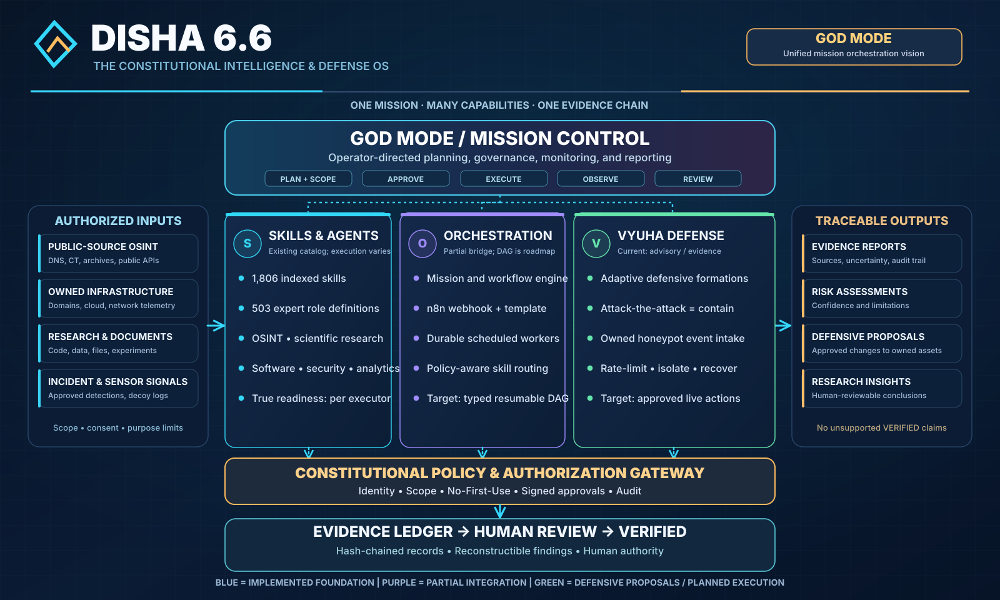

<div align="center">

# DISHA 6.6
### The Constitutional Intelligence & Defense Operating System

**One mission. Many capabilities. One evidence chain.**

A governed, evidence-first platform combining **OSINT, scientific research, authorized cybersecurity assessment, defensive threat intelligence, adaptive VYUHA formations, honeypot telemetry, and multi-agent automation**.

[](https://github.com/Tashima-Tarsh/Disha6.6/actions/workflows/ci.yml)
[](https://github.com/Tashima-Tarsh/Disha6.6/actions/workflows/e2e-spine.yml)
[](LICENSE)
[](package.json)
[](package.json)

[Architecture](#system-architecture) · [Capabilities](#capabilities--implementation-status) · [GOD MODE](#god-mode--the-unified-mission-vision) · [VYUHA](#vyuha--adaptive-defensive-formations) · [Quick Start](#quick-start) · [Roadmap](#roadmap)

</div>

---

## The intelligence platform where evidence comes before conclusions

DISHA 6.6 is a modular **Constitutional Evidence Operating System**. It is designed to let an operator conduct a mission spanning public-source research, authorized infrastructure assessment, software and scientific analysis, and defensive incident response—without losing source provenance, policy controls, or human accountability.

> **Core principle:** No claim becomes knowledge until it is sourced, policy-checked, recorded as evidence, and human-reviewable.

```text
Source / Sensor → Governed Adapter Bus → EvidenceEvent
                → Mission Correlation → Human Review → VERIFIED Finding
```

The project is not defined by the number of collectors it can list. It is defined by its commitment to make decisions **traceable, reconstructible, contestable, and safe to act upon**.

## System architecture



<div align="center">
  <sub><strong>Architecture map:</strong> blue denotes established foundations, purple denotes partial orchestration integration, and green denotes governed defensive proposals with further execution work planned. <a href="docs/ORCHESTRATION_ARCHITECTURE.md">Explore the full architecture blueprint.</a></sub>
</div>

### The operating model

| Layer | Function | Source |
|---|---|---|
| **Mission Control** | Capture objectives, organize missions, present decisions, and route reviews | `packages/mission/`, `web/` |
| **Constitutional Gateway** | Authenticate, enforce scope, classify risk and apply human approvals | [`CONSTITUTION.md`](CONSTITUTION.md), `web/lib/unified/policy-gate.ts` |
| **Skills & Agents** | Discover indexed expert roles, instructions, and category-specific executors | `web/lib/skills/skill-registry.ts`, `.agents/` |
| **OSINT & Scanning** | Public-source adapters and approved, bounded infrastructure checks | `packages/adapter-bus/`, `packages/adapters/`, `backend/` |
| **Workflow Runtime** | Process selected durable jobs and integrate incoming n8n events | `web/lib/unified/workflow-executor.ts`, `web/app/api/v1/workflows/n8n/` |
| **VYUHA Defense** | Analyze signals and propose No-First-Use defensive formations | `skills/vyuha-defense-engine/`, `web/lib/extensions/vyuha-defense.ts` |
| **Honeypot Evidence** | Admit and analyze telemetry from owned or authorized deception environments | `web/lib/extensions/honeypot-evidence.ts` |
| **Evidence & Verification** | Hash-chain observations, preserve decisions and route claims to human review | `packages/evidence-ledger/`, `packages/review/` |

### Canonical constitutional packages

| Package | Responsibility |
|---|---|
| `@disha/contracts` | `VerificationState`, `EvidenceEvent`, `Adapter`, `PolicyDecision` |
| `@disha/evidence-ledger` | Tamper-evident, hash-chained evidence events; persistence abstractions |
| `@disha/adapter-bus` | Governs external observations under common contracts |
| `@disha/mission` | Case/mission lifecycle and legal state model |
| `@disha/review` | Human review queue; source of authority for `VERIFIED` |
| `@disha/orchestrator` | Composition of evidence, policy and mission components |
| `@disha/api` | Fail-closed HTTP interface |

The wider monorepo also includes Next.js, Python, OSINT, AI, MCP, and earlier Brain/experimental systems. **Their presence does not mean they all run as one production system today.** See [Current Status](docs/CURRENT_STATUS.md) and the [Unified Orchestration Blueprint](docs/ORCHESTRATION_ARCHITECTURE.md).

---

## GOD MODE — the unified mission vision

**GOD MODE** is the name for the proposed highest-capability DISHA workbench: **one operator-directed mission, many specialized capabilities, one governed execution and evidence trail**.

It is **not** a permission bypass, autonomous privilege escalation, or a promise to scan unrelated systems without authorization.

A GOD MODE mission is designed to:

1. **Understand** a research, audit, incident or investigation objective and define its authorized scope.
2. **Plan** a dependency-aware workflow across relevant tools and expert roles.
3. **Orchestrate** capable workers, sources and datasets using typed steps and approvals.
4. **Observe** progress, execution status, sources, uncertainty, timeouts and failures.
5. **Defend** controlled infrastructure with defensive containment and deception telemetry.
6. **Verify** findings through evidence and qualified human review.
7. **Deliver** reconstructible reports, scientific results, forensic timelines or approved actions.

**The vision is universal orchestration; the existing product foundation is constitutional evidence and bounded missions.**

## Capabilities & implementation status

The following counts describe **indexed metadata**, not verified live operations. Source baseline: 25 October 2026.

| Domain | Capability | Implementation reality |
|---|---|---|
| **Skills** | **1,806** indexed skill definitions across 9 categories | Domain-specific executors exist; many catalog entries still need genuine bindings and smoke tests |
| **Expert roles** | **503** indexed expert role definitions | Instructions/personas available; not 503 independently validated autonomous workers |
| **OSINT** | Public domain, DNS, certificates, archives, IP and GitHub adapters, plus Python collectors | Working code paths exist; readiness depends on adapter, permissions, credentials and dependencies |
| **Scanning & assessment** | Configuration checking, public research and bounded owned-environment validation | High-risk/active operations require explicit scope and authorization |
| **Scientific research** | Numerical and model configuration tools, AI research and specialist skills | Selected paths exist; broad coverage requires real tool execution tests |
| **Orchestration** | Mission engine, selected durable workflow jobs and n8n webhook/template | **Partial**; universal DAG and all-skills integration are roadmap |
| **VYUHA** | Defensive formation rules, classifiers and proposals | **Advisory/proposal path**; controlled live-action execution is not yet complete |
| **Honeypots** | Owned-environment telemetry admission | **Evidence intake**, not automatic honeypot deployment |
| **Breach intelligence** | Defensive exposure-oriented metadata/dataset adapters | Requires source validation, privacy and provenance safeguards |
| **Evidence** | Hash-chained ledger, verification states and human review | **Core implemented**; deployment assurance and end-to-end consistency must be tested |

### What “Zero Simulation” should mean

A real execution reports a **real result**. The registry's ability to load an instruction or summarize a persona is not proof that the named external task happened.

DISHA's target execution lifecycle therefore separates:

```text
CATALOGUED → BINDING_VALIDATED → READY → SMOKE_PASSED → PRODUCTION_READY

QUEUED → RUNNING → SUCCEEDED | PARTIAL | FAILED | BLOCKED | NOT_EXECUTED
```

Only jobs that actually invoke a bound executor and produce a validated result should claim `SUCCEEDED`. Unsupported tools should say `NOT_EXECUTED`, not invent findings.

### Skill families

| Category | Indexed skills |
|---|---:|
| Scientific computing | 764 |
| AI research | 311 |
| Software engineering | 257 |
| General | 143 |
| Design / frontend | 139 |
| Cybersecurity | 100 |
| Computer networking | 74 |
| Cognitive memory | 13 |
| Intelligence / OSINT | 5 |
| **Total** | **1,806** |

---

## VYUHA — adaptive defensive formations

VYUHA applies classical formation concepts to **defensive security posture selection**. Examples of formation rule files include Chakra, Garuda, Kurma and Padma, under [`skills/vyuha-defense-engine/formation-rules/`](skills/vyuha-defense-engine/formation-rules/).

```text
Trusted alert / sensor → Classify threat → Select formation
                       → Constitutional policy → Approval when needed
                       → Defensive proposal / owned-asset action
                       → Preserve evidence → Review and recovery
```

### “Attack the Attack” — defensive doctrine

This phrase means **disrupt the attacker's progress inside the environment the defender controls**, not offensive retaliation. Examples include:

- Detect and correlate indicators and event timelines.
- Rate-limit malicious traffic at owned enforcement points.
- Isolate compromised hosts, quarantine suspicious files and revoke compromised credentials.
- Capture evidence, rotate keys, restore known-good state and verify recovery.
- Analyze attacker behavior using **isolated, owned honeypots** and recorded telemetry.

**Current maturity:** the web VYUHA extension proposes actions but does not directly execute its Python formation runner. Honeypot integration handles owned-environment evidence intake; it does not independently deploy honeypots. The planned live-action layer requires signed authorization, explicit asset scope, rollback and test coverage.

---

## OSINT, scanning, breach awareness & research

DISHA aims to bring public-source discovery, authorized assessments and defensive research into an evidence-centered mission flow.

- **OSINT:** DNS, certificate transparency, archives, public GitHub metadata and permitted data sources.
- **Authorized security assessment:** owned domains, services, API configurations, network controls and bounded checks.
- **Breach exposure awareness:** verified notifications and lawful exposure metadata—without ingesting stolen credentials or redistributing leaked personal records.
- **Research and analysis:** technical documents, models, code, datasets, reproducible experiments and evidence-linked synthesis.
- **Deception and threat hunting:** permitted sensors and isolated, owned honeypot telemetry.

Collection and scanning are subject to **law, authorization, source terms, privacy controls and risk-based permissions**. The architecture intentionally separates passive observation from privileged or active operations.

## n8n-style orchestration

DISHA already contains:

- `POST /api/v1/workflows/n8n/webhook` — authenticated, schema-validated event bridge.
- `GET /api/v1/workflows/n8n/schemas` — example workflow template.
- `web/lib/unified/workflow-executor.ts` — worker for defined source-ingestion, OSINT-watch and intelligence-activation jobs.

These are **building blocks**, not a general-purpose workflow graph that has been proven to run every indexed skill.

**Planned workflow contract:**

```text
Trigger → Authenticate & scope → Evaluate policy → Build typed mission DAG
        → Invoke real capability → Log evidence → Human review
        → Return status and artifacts → Continue / compensate / close
```

For the intended job state machine, capability manifests, retries, worker isolation, approval nodes, failure handling and n8n callbacks, see [Orchestration Architecture](docs/ORCHESTRATION_ARCHITECTURE.md).

---

## Governed n8n skill orchestration (new, bounded)

The web API now accepts authenticated, sequential skill workflows at
`POST /api/v1/workflows/n8n/skills`. An importable n8n template is available
from `GET /api/v1/workflows/n8n/schemas` (field `governedSkillWorkflow`).

A registry entry or expert prompt is **not** proof of runtime capability.
The 1,806 indexed skill records and 503 role instruction personas have different
execution maturity. Unsupported instruction-only capabilities report
`NOT_EXECUTED`; no packet capture, model training, or domain verification is
implied merely by loading a skill. Workflows stop on a denied, unsupported, failed,
or unevidenced step, and final results are ledger-recorded.

See [Governed Skill Orchestration](docs/GOVERNED_SKILL_ORCHESTRATION.md) for the
architecture, request example, n8n credentials setup, authorization boundaries and
remaining integration milestones.

---

## Evidence is the product

Every finding carries exactly one verification state:

`OBSERVED` · `INFERRED` · `CORRELATED` · `PREDICTED` · `VERIFY_REQUIRED` · `VERIFIED` · `REJECTED`

No model, adapter, agent or dataset may independently promote a claim to **`VERIFIED`**. That transition requires an evidence-supported review by an authorized human actor.

A hash-chained ledger provides **tamper evidence**; it does not automatically prove that an external source is truthful or that a report is legally admissible in every jurisdiction.

## Quick start

### Requirements

- **Node.js 22.x** for the current web workspace.
- Python dependencies for the OSINT backend when using that service.
- PostgreSQL / Redis and configured service credentials where required by the selected runtime.

```bash
git clone https://github.com/Tashima-Tarsh/Disha6.6.git
cd Disha6.6

# Start Next.js web development workspace
npm --prefix web ci
npm --prefix web run dev
```

The development web interface normally uses `http://localhost:3000`. Connected API routes require appropriate environment configuration and running backend dependencies. **Do not expose a development stack or example database credentials on public networks.**

### Constitutional API

The separate `@disha/api` service is documented at [docs/API.md](docs/API.md) (default local port `8787`). Configure `DISHA_API_KEY`; durable production deployments require a configured PostgreSQL store.

Example API request shape:

```http
POST /v1/missions
Authorization: Bearer <DISHA_API_KEY>
Content-Type: application/json

{"title":"Authorized public-domain check","activate":true}
```

```http
POST /v1/missions/:id/run
Authorization: Bearer <DISHA_API_KEY>
Content-Type: application/json

{"adapterIds":["dns-lookup","crtsh"],"input":{"domain":"example.com"}}
```

### Validate your environment

```bash
npm --prefix web run lint
npm --prefix web run type-check:full
npm --prefix web test
npm --prefix web run build
```

**CI status:** at the 25 October 2026 audit baseline, the E2E Constitutional Spine passed, but Fast CI failed during lint. The live workflow badges show current status. Do not interpret the existence of a script or test as a green production release.

---

## Security & constitutional rules

This repository follows the [DISHA Constitution](CONSTITUTION.md) and [Security Policy](SECURITY.md):

1. **Authorization first:** permission, ownership and target scope are required for active operations.
2. **No First Use:** no retaliation or unauthorized targeting of external systems.
3. **Models are advisory:** AI cannot self-authorize high-impact actions or produce `VERIFIED` findings.
4. **Governed adapters:** external observation uses registered, policy-checked interfaces.
5. **Fail closed:** missing credentials, invalid approvals and integrity failures block privileged execution.
6. **Privacy:** limit retention, redact sensitive data and exclude stolen credentials or unlawfully obtained records.
7. **Reproducibility:** distinguish observed facts, deductions, predictions and human conclusions.

Please report security vulnerabilities privately through [GitHub Security Advisories](https://github.com/Tashima-Tarsh/Disha6.6/security/advisories), not public issues.

## Roadmap

- [x] Constitutional core, adapter contracts and evidence/review packages
- [x] Public-source adapter implementations and governed mission examples
- [x] Skill registry with 1,806 indexed skill definitions
- [x] Expert-role index with 503 role definitions
- [x] Initial n8n webhook/template and scheduled workflow worker
- [x] VYUHA formation manifests, advisory proposals and owned honeypot evidence intake
- [ ] Consistently green Fast CI, typecheck, audit and release pipeline
- [ ] Remove synthetic successes and implement truthful per-skill readiness metrics
- [ ] Ensure trusted identity and signed grants flow to every executor
- [ ] Consolidate mission, policy and evidence contracts across runtimes
- [ ] Universal typed, resumable n8n-style DAG orchestration with real worker bindings
- [ ] Approved defensive-action plane for owned VYUHA networks and deception sensors
- [ ] Audited workflow and evidence replay from intent through human verification
- [ ] Independent security review and production-grade recovery testing

**Success measure:** a third-party auditor can reconstruct each published conclusion and show which real tools ran, which policies applied, which evidence was observed, and who verified the result.

## Documentation

| Resource | What it covers |
|---|---|
| [Constitution](CONSTITUTION.md) | Binding authorization, verification, provenance and No-First-Use rules |
| [Unified Orchestration Blueprint](docs/ORCHESTRATION_ARCHITECTURE.md) | Dynamic mission DAG, skills, n8n, VYUHA, workflow contracts and roadmap |
| [Current Status](docs/CURRENT_STATUS.md) | Repository-maintained implementation status |
| [API](docs/API.md) | Constitutional mission, adapter, review and integrity endpoints |
| [Evidence Ledger](docs/EVIDENCE_LEDGER_V3.md) | Hash-chain model and integrity concepts |
| [Adapter Bus](docs/ADAPTER_BUS.md) | Governed source/collector contract |
| [Production Roadmap](docs/PRODUCTION_ROADMAP.md) | Durability, security, adapters and assurance |
| [Security](SECURITY.md) | Vulnerability disclosure and trust boundaries |

## Contributing & license

Contributions in adapters, scientific research skills, defensive telemetry, workflow integration, documentation, accessibility and testing are welcome. A capability should not claim production readiness without a real executor, scoped permission model, smoke-test evidence and a meaningful failure state.

See [CONTRIBUTING.md](CONTRIBUTING.md), [CODE_OF_CONDUCT.md](CODE_OF_CONDUCT.md) and the [MIT license](LICENSE). Individual third-party tools, datasets and bundled skills may carry separate licenses or usage restrictions.

---

<div align="center">

### DISHA 6.6

**Intelligence that protects. Automation that empowers. Evidence you can verify.**

**One mission. Many minds. One evidence chain.**

</div>