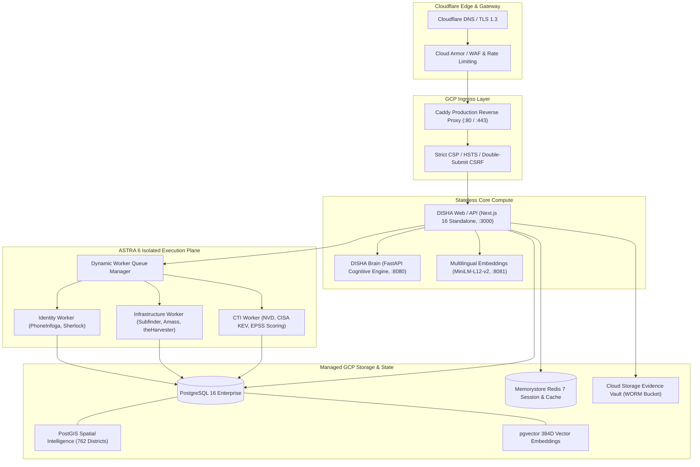

# DISHA 6.6
### Evidence-Grade Intelligence & Constitutional Defense Operating System

[](LICENSE)
[](https://cloud.google.com)
[-000000?logo=nextdotjs&logoColor=white)](https://nextjs.org)
[](https://www.postgresql.org)
[](https://threejs.org)
[](https://github.com/Tashima-Tarsh/Disha6.6)
[-00b0ff?logo=safari&logoColor=white)](https://thenitishkr.in)

---

## 1. Executive Overview

**DISHA 6.6** (Defense Intelligence & Sovereign Homeland Analytics) is an enterprise-grade cognitive defense and intelligence operating system engineered for national security analysts, cyber-defense operators, and sovereign command authorities.

Built around a foundational **Truthful Intelligence Architecture**, DISHA 6.6 strictly enforces zero-fabrication guarantees:
* **Evidence-Grade OSINT:** All intelligence representations are strictly bound to authenticated, runtime-proven sources with cryptographic provenance.
* **Truthful Status Representation:** In the absence of live sensor or connector configurations, systems truthfully render `UNCONFIGURED`, `UNAVAILABLE`, `DEGRADED`, or `EMPTY` states rather than generating synthetic operational-looking records.
* **Dual-Scene 3D Separation:** Clear isolation between pre-authentication visualization (`DishaIdentityScene3D`) and authenticated post-login intelligence investigation (`DishaOsintUniverse3D`).
* **Constitutional Contradiction & Corroboration Engine:** Automated detection of statement vs. statement conflicts, gazette-to-action discrepancies, and independent source family validation.
* **Cryptographic Tamper-Evident Ledger:** Every indicator, observation, and entity relationship is chained into an immutable SHA-256 Merkle-anchored evidence ledger.

```
OPERATIONAL DATA CHAIN:
Public Sensor Intercept ──► Universal Target Classifier ──► Constitutional Policy Gate ──► ASTRA 6 Worker Bus ──► SHA-256 Evidence Vault ──► Analyst Review
```

---

## 2. 3D Spatial Gateway & Visual Architecture

DISHA 6.6 separates pre-authentication visual identity from post-login intelligence operations into two distinct, high-performance WebGL environments:

### Pre-Auth Identity Scene (`DishaIdentityScene3D`)
A dedicated, top-tier 3D authentication environment providing a physically grounded Earth model:
* **Sovereign India Centering:** Mathematically oriented on initial load ($R_y = -78.5^\circ, R_x = +22.5^\circ$) so Central India ($78.5^\circ\text{ E}, 22.5^\circ\text{ N}$) directly faces the camera lens.
* **Authoritative Cartography:** Instant frame-1 synchronous shoreline rendering backed by asynchronous streaming of `world-countries.geojson` and official `datameet-india-land-simplified.geojson` boundaries with a restrained metallic gold/ivory highlight (`#d4af37`).
* **Physical Atmospheric Luminescence:** Restrained back-side rim glow (`#45c7f4`), directional sunlight (`#e8f2ff`, 2.0 intensity), fine cartographic graticules, and a subtle Tropic of Cancer marker ($23.436^\circ\text{ N}$).
* **Centered Spatial Gateway Card:** Compact 370px maximum width, floating with subtle pointer parallax, frosted glassmorphism (`backdrop-filter: blur(20px)`), and seamless support for credential authentication and national OIDC federation (`meri-pehchan`, `intra-id`).
* **Strict Non-Operational Policy:** Zero fake satellites, zero synthetic threat nodes, and zero simulated telemetry prior to authentication.

### Post-Login Intelligence Universe (`DishaOsintUniverse3D`)
Upon authenticated handshake, the workspace transitions into a full-scale 3D intelligence investigation environment:
* Real-time geospatial mapping of verified external intelligence assets.
* Interactive multi-source relationship graphing, attack surface nodes, and CTI indicators.
* Live connector health inspection across 125+ cataloged OSINT / CTI / SPACEINT sources.
* Full analytical investigation drawers and evidence inspection views.

---

## 3. Core Capabilities & Subsystems

### A. Universal OSINT Search & Source Registry
* Unified discovery across passive DNS, RDAP, Certificate Transparency (crt.sh), public registries, and vulnerability databases.
* Strict governance distinctions enforced across all modules:
  $$\text{CATALOGED} \neq \text{IMPLEMENTED} \neq \text{CONFIGURED} \neq \text{HEALTHY} \neq \text{EXECUTED} \neq \text{RETURNED EVIDENCE}$$

### B. ASTRA 6 Distributed Worker Plane
CLI-heavy and specialized intelligence tools run outside the Next.js process boundary in hardened, non-root worker containers:
* **Identity OSINT:** `PhoneInfoga` (v2.11.0), `Sherlock` (v0.15.0) — gated behind explicit operator policy approval.
* **Infrastructure Reconnaissance:** `ProjectDiscovery Subfinder` (v2.6.6), `OWASP Amass` (v4.2.0 passive), `theHarvester` (v4.6.0 passive).
* **Cross-Domain Correlation:** `SpiderFoot` (v4.0.0) is cataloged for a future isolated passive-only runtime; it is not executable in the current worker image.
* **Command Injection Guards:** All worker arguments are validated against strict regex boundary guards before process dispatch via `execFile`.

### C. Cyber Defense & Attack Surface Engine
* Automatic technology fingerprinting, subsea cable landing correlation, and national infrastructure asset classification.
* CVE-to-CISA-KEV (Known Exploited Vulnerabilities) mapping and FIRST EPSS score computation.
* Look-alike domain detection and typosquatting defenses.

### D. Constitutional Evidence Vault
* Content-addressable SHA-256 storage for all raw analyst observations and artifacts.
* Merkle-tree verification guaranteeing non-repudiation.
* Policy Rule: AI agents are cryptographically barred from marking an observation `VERIFIED`. Human analyst sign-off is strictly mandatory.

---

## 4. GCP Distributed Enterprise Architecture

DISHA 6.6 is deployed on Google Cloud Platform in the `asia-south1` (Mumbai) region:



---

## 5. Repository Structure

```
Disha6.6/
├── web/                           # Next.js 16 Production Frontend & API Gateway
│   ├── app/                       # App Router routes (/login, /workbench, /vault, etc.)
│   ├── components/                # React UI components
│   │   ├── auth/                  # DishaIdentityScene3D & spatial gateway styles
│   │   ├── visual/                # OsintUniverse3D & 3D visualization systems
│   │   └── ui/                    # Primitive design tokens and components
│   ├── database/                  # SQL migrations & rollback scripts
│   ├── lib/                       # Core unified logic
│   │   ├── server/                # Session auth, CSRF, rate-limit, audit logging
│   │   └── unified/               # Adapters, buses, source registry, ASTRA 6 manifests
│   ├── public/                    # Static assets & authoritative GeoJSON datasets
│   ├── scripts/                   # Build, seed, asset copy, and worker scripts
│   └── tests/                     # Vitest regression test suite (45 test files, 299 tests)
├── disha/                         # DISHA Brain FastAPI cognitive microservice
├── infra/                         # Infrastructure Dockerfiles (PostgreSQL, Caddy, etc.)
├── scripts/                       # Root governance and operational orchestration
│   └── governance-check.mjs       # Strict policy, secret, and line-limit linter
├── docker-compose.yml             # Local Docker Compose configuration
├── docker-compose.gcp.yml         # GCP production deployment configuration
├── LICENSE                        # MIT License
└── README.md                      # Platform documentation
```

---

## 6. Quickstart & Local Development

### Prerequisites
* **Node.js:** `22.x`
* **Docker & Docker Compose:** Latest stable
* **PostgreSQL:** `16+` with `postgis` and `pgvector` extensions
* **Redis:** `7+`

### 1. Installation
```bash
# Clone the repository
git clone https://github.com/Tashima-Tarsh/Disha6.6.git
cd Disha6.6

# Install web dependencies
npm --prefix web ci
```

### 2. Database Migration & Authoritative GeoJSON Import
```bash
# Apply SQL migrations
npm --prefix web run db:migrate

# Import authoritative India district and shoreline boundaries
npm --prefix web run geo:import
```

### 3. Running Development Server
```bash
npm run dev
# The application will be available at http://localhost:3000
```

### 4. Running the Full Containerized Stack
```bash
docker compose up --build
```

---

## 7. Verification & Production Quality Gates

DISHA 6.6 enforces automated quality and governance gates on every commit:

```bash
# 1. Full TypeScript verification across all application components
npm --prefix web run type-check:full

# 2. Comprehensive Vitest regression test suite (299 passing tests)
npm --prefix web run test

# 3. Next.js Turbopack standalone production build
npm --prefix web run build

# 4. Strict governance, secret-leak, and policy gate check
node scripts/governance-check.mjs

# 5. Git whitespace and format verification
git diff --check
```

### Mandatory Production Directives
* **Zero-Mock Policy:** Synthetic records are strictly banned from production adapters. Missing data must be rendered as `UNCONFIGURED` or `EMPTY`.
* **Logging Compliance:** `console.info()` strictly enforced across all components; `console.log()` is blocked by governance checks.
* **Zero Technical Debt:** Zero `TODO`, `FIXME`, `HACK`, `@ts-ignore`, or `eslint-disable` markers permitted in merged branches.
* **Non-Repudiation Rule:** Automated systems are cryptographically barred from self-assigning a `VERIFIED` state to any evidence. Human operator sign-off is mandatory.

---

## 8. License & Attribution

This project is licensed under the **MIT License** — see the [LICENSE](LICENSE) file for details.

```
MIT License

Copyright (c) 2026 Nitish Kumar (thenitishkr) <https://thenitishkr.in>
```

Crafted for sovereign intelligence defense and constitutional transparency by **Nitish Kumar** ([@thenitishkr](https://thenitishkr.in)).
