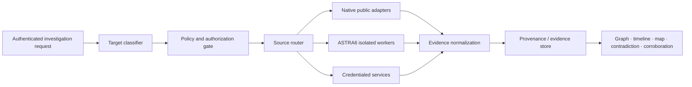
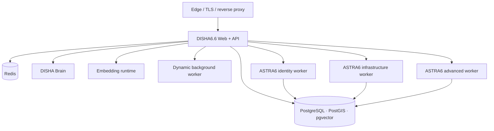

# DISHA6.6
## Constitutional Evidence Operating System

DISHA6.6 is an evidence-first intelligence operating system for governed public-source investigation, constitutional accountability, cyber-defense analysis, source verification, relationship discovery, and durable evidence handling.

The product is designed around one non-negotiable rule:

> **Real data or no data.**

DISHA6.6 does not create synthetic intelligence to make a screen look populated. A missing connector is shown as unconfigured. A failed source is shown as failed. A policy-gated tool remains restricted. A search with no evidence returns no evidence. Catalog metadata is never treated as proof that a runtime is installed, configured, healthy, or authorized.

The architecture follows long-lived enterprise-system principles: explicit trust boundaries, bounded execution, fail-closed policy, separation of control plane and data plane, immutable provenance semantics, small production surfaces, durable state ownership, measurable readiness, and graceful degradation.

---

## What DISHA6.6 does

DISHA6.6 turns a governed investigation request into a source-linked evidence workspace.

A user can start from a person, organisation, domain, URL, IP address, ASN, CVE, email address, phone number, username, vehicle identifier, repository, file hash, indicator, certificate, location, topic, image, or other supported identifier. The system classifies the target, selects approved adapters, applies policy, executes bounded public-source retrieval, normalizes returned observations, records provenance, and exposes the resulting evidence through investigation views such as:

- Overview
- Evidence
- Sources
- Entity graph
- Timeline
- Map
- Contradictions
- Corroboration
- Raw source-linked records

The product also contains mission, evidence-vault, cyber-defense, system-control, geospatial, continuous-intelligence, and audit surfaces. Capabilities become operational only when the corresponding runtime, data source, credentials, policy approval, and persistence dependencies are actually available.

---

## Product operating model



### Control plane

The Next.js application owns authentication, request validation, policy enforcement, runtime status, investigation orchestration, evidence contracts, source admission, and operator-facing control surfaces.

### Execution plane

Heavy or specialized command-line OSINT runs outside the web request process through isolated ASTRA6 workers. Each worker has an explicit tool allowlist, bounded target validation, timeouts, authorization checks, non-root execution, read-only container posture, and a database-backed job lifecycle.

### Intelligence / research plane

The DISHA Brain runs as a separate governed analysis service. It may analyze admitted information, but generated model output does not automatically become evidence.

### Persistence plane

Production persistence is designed around PostgreSQL with PostGIS and pgvector support, Redis for runtime coordination/cache patterns, and controlled evidence storage. If durable persistence is unavailable, the application must report that state rather than pretending that an observation has been committed.

---

## Truth model

DISHA6.6 deliberately separates four concepts that are often incorrectly collapsed into one:

| State | Meaning |
| --- | --- |
| **Cataloged** | The project/source is known to DISHA6.6. This does not mean it is installed or runnable. |
| **Upstream verified** | The upstream repository or endpoint has been verified as existing/reachable at verification time. This does not establish runtime readiness. |
| **Runtime manifested** | DISHA6.6 has an owned execution contract, parser, worker placement, and policy model for the tool. |
| **Runtime ready / healthy** | The deployed environment has the required binary/service, configuration, credentials, policy approval, worker heartbeat, and successful probe. |
| **Evidence returned** | A specific investigation produced source-linked records. |
| **Corroborated / contradicted** | Multiple admitted records support or conflict with a claim under the analysis rules. |

A repository lockfile is provenance and deployment metadata. It is **not** live telemetry.

Live readiness should be read from the running product, for example:

- `/api/v1/health`
- `/api/v1/runtime/status`
- `/api/v1/production/readiness`
- `/api/v1/osint/tools`
- `/api/v1/osint/tools/health`

---

## Governed OSINT capabilities

DISHA6.6 contains two different OSINT layers: native governed adapters and a larger upstream catalog. The upstream catalog is useful for discovery and provenance, but only explicitly wired adapters and workers are part of the execution plane.

### Native public-source adapters

The default governed adapter bus includes production code for the following source families:

**Internet and infrastructure**
- Google Public DNS
- Certificate Transparency
- RDAP
- RIPEstat
- Wayback Machine CDX
- Common Crawl

**Vulnerability and defensive cyber intelligence**
- CISA Known Exploited Vulnerabilities
- NVD CVE
- FIRST EPSS
- abuse.ch ThreatFox
- abuse.ch MalwareBazaar

**Public reporting and humanitarian intelligence**
- GDELT
- ReliefWeb

**Government, registry and knowledge sources**
- SEC EDGAR
- Wikidata
- OpenAlex
- World Bank public data
- CelesTrak orbital data
- NOAA Space Weather Prediction Center

**Entity and corporate discovery**
- OpenSanctions
- OpenCorporates

**Vehicle and identifier handling**
- NHTSA VIN
- Indian vehicle-registration format validation

**Service-backed intelligence**
- OpenCTI
- IntelOwl

**Extensible public sources**
- governed dynamic public-source adapter
- official public-source probe adapter

Availability depends on the individual source, network, configuration, credentials, licensing, and runtime policy.

### ASTRA6 managed worker tools

The owned ASTRA6 manifest layer currently defines these isolated tools:

| Tool | Primary role | Execution posture |
| --- | --- | --- |
| PhoneInfoga | phone-number public OSINT | identity authorization required when used for an investigation |
| Sherlock | username presence discovery | identity authorization required |
| Maigret | username presence discovery | identity authorization required |
| Holehe | bounded email account-presence checks | identity authorization required |
| Instaloader | public Instagram profile metadata | governed public profile use |
| Telegram Public Metadata / Telethon | public Telegram resolution | operator-owned API credentials/session required |
| theHarvester | passive domain intelligence | passive allowlist |
| SpiderFoot | multi-source passive correlation | active modules blocked |
| OWASP Amass | passive asset discovery | passive mode |
| ProjectDiscovery Subfinder | passive subdomain discovery | passive mode |
| Recon-ng | allowlisted public modules | arbitrary marketplace execution blocked |
| Photon | bounded same-site public URL discovery | explicit active-recon approval required |

The primary investigation router currently invokes only the tools appropriate to a supported target and policy state. Merely being present in the ASTRA6 manifest does not mean a tool will execute for every search.

### Cataloged upstream inventory

`data/osint/upstream-registry.json` is the broader upstream inventory. It contains projects across identity, network, framework, threat-intelligence, archives, metadata, media, documents, datasets, libraries, GUI tools, and service runtimes.

That file is a **catalog and provenance source**, not a live-health database.

For a machine-generated inventory use:

```bash
npm run osint:report
```

For deployed runtime readiness use the live runtime endpoints or:

```bash
npm run osint:health
```

The two outputs answer different questions and must not be conflated.

---

## Investigation routing

The investigation router applies target-specific execution plans.

Examples of supported routing include:

- **Domain / URL** → DNS, certificate transparency, RDAP, archives, public reporting, passive infrastructure workers, optional Shodan, optional OpenCTI / IntelOwl, threat-intelligence enrichment.
- **IP / ASN** → RDAP / RIR context, public reporting, optional passive service intelligence.
- **CVE** → CISA KEV, NVD, FIRST EPSS and public reporting.
- **Person / company** → Wikidata, GDELT, optional Brave Search, OpenSanctions, OpenCorporates.
- **Email / phone / username** → public reporting plus explicitly authorized identity tools when deployment and operator policy permit them.
- **File hash / IOC** → defensive threat-intelligence services such as ThreatFox, MalwareBazaar, OpenCTI and IntelOwl where configured.
- **Vehicle identifier** → format validation and only authorized registry connectors; protected owner data is not silently queried.
- **Image** → local metadata analysis and optional Google Cloud Vision Web Detection when explicitly configured.
- **NORAD / space-weather / humanitarian topics** → purpose-built public scientific or official adapters.

Restricted, private, stolen, credential-abuse, intrusive, or unapproved sources are not treated as normal search providers.

---

## Evidence architecture

An observation is not considered trustworthy merely because an adapter returned it.

DISHA6.6 carries evidence metadata through the investigation lifecycle, including source identity, adapter identity, retrieval time, source URL where applicable, content hash, provenance hash, candidate association, corroboration state, and contradiction state.

The product is structured so that:

1. retrieval creates an observation;
2. normalization gives that observation a stable evidence contract;
3. provenance records where it came from;
4. entity resolution may associate it with candidates;
5. corroboration or contradiction analysis evaluates relationships between admitted records;
6. operator review determines how the result is used.

A model-generated sentence is not promoted to verified evidence by default.

---

## Production architecture



### Architectural decisions

**1. The web tier is not the CLI worker tier.**  
Specialized tools do not execute inside request handlers. This limits blast radius and keeps request latency independent from long-running OSINT processes.

**2. Policy is checked before execution and again at the worker.**  
Identity enumeration and active crawling require explicit deployment policy plus investigation-level authorization. A queue record cannot bypass the worker-side policy check.

**3. Workers are bounded.**  
Targets are validated, shell metacharacters are blocked, commands are executed without a shell, timeouts are enforced, and late results are discarded when the investigation has closed.

**4. Readiness is environment-specific.**  
The codebase may know how to run a connector while a particular deployment still reports `NOT_CONFIGURED`, `AUTH_REQUIRED`, `RESTRICTED`, `DEGRADED`, or `UNAVAILABLE`.

**5. Archive code is not production code.**  
Historical and imported research trees must not become runtime dependencies accidentally. Promotion into the product requires an owned adapter, policy boundary, evidence contract, tests, and maintenance owner.

---

## Failure behavior

DISHA6.6 is designed to fail visibly and locally.

| Failure | Required product behavior |
| --- | --- |
| Database missing | report persistence as unconfigured; do not claim durable evidence |
| Worker missing / heartbeat stale | mark the relevant ASTRA capability unconfigured or degraded |
| Credential absent | `AUTH_REQUIRED` / `NOT_CONFIGURED` |
| Policy approval absent | `RESTRICTED` / blocked by policy |
| Provider rate limit | return rate-limited status for that source without inventing a result |
| Provider timeout | mark that source failed/timed out; other independent sources may continue |
| No source-backed records | return an empty evidence state |
| Unknown / catalog-only tool | show catalog/reference status, not healthy runtime status |
| Invalid or empty search | reject the request; do not substitute a fabricated default investigation |
| Evidence persistence unavailable | expose live-unpersisted state explicitly |
| Contradiction/corroboration unavailable | show no findings, not synthetic confidence values |

---

## Performance and scale design

The system is optimized through architecture rather than optimistic UI claims.

- **Stateless web tier:** request handling remains horizontally scalable.
- **Asynchronous heavy work:** ASTRA6 execution and scheduled work are separated from user-facing request handlers.
- **Database-backed worker leases:** work can be claimed safely without multiple workers processing the same queued job.
- **Bounded worker classes:** identity, infrastructure and advanced tools can scale independently.
- **Connection reuse:** database and Redis clients are shared through server-side runtime modules rather than recreated per UI component.
- **Source parallelism:** independent public adapters can execute concurrently.
- **Short-lived investigation state:** ephemeral investigations have explicit cleanup and expiry behavior.
- **Separated embedding and reasoning services:** model workloads do not have to share the web process.
- **Small container contexts:** production Docker context excludes historical, demo and generated-report material.
- **Read-only containers:** production services run with read-only filesystems where practical and use tmpfs only for bounded temporary work.
- **Non-root workers:** ASTRA6 worker images execute as dedicated non-root users.
- **Fail-fast health checks:** PostgreSQL, Redis, web, brain and embedding dependencies expose startup/readiness checks.

---

## Repository ownership boundaries

The repository contains both product code and retained research/history. The production spine is intentionally narrow.

### Production product

- `web/` — authenticated application, API gateway, policy, evidence, runtime control and operator UI
- `web/services/` — investigation/application services
- `web/lib/server/` — auth, persistence, audit, rate limiting and server-only controls
- `web/lib/unified/` — governed adapters, routing, evidence contracts, source registry and runtime orchestration
- `web/scripts/` — production workers and operational scripts
- `disha/brain/` — governed intelligence/research service
- `infra/` — PostgreSQL and worker container definitions plus GCP infrastructure
- `data/osint/` — source catalog and provenance metadata
- `scripts/osint/` — catalog verification, classification, smoke and report tooling

### Retained archive / research

- `legacy/`
- `disha/legacy-root-src/`
- research-only integration trees
- demo payloads
- generated reports and local analysis artifacts

Archive code is not considered a production dependency merely because it remains in Git history or the monorepo.

---

## Security posture

Production controls include:

- authenticated application routes;
- role-aware execution;
- CSRF controls;
- strict input schemas;
- SSRF-aware public retrieval;
- bounded request and file sizes;
- parameterized database access;
- evidence hashing and provenance;
- worker command-injection guards;
- worker allowlists;
- non-root containers;
- dropped Linux capabilities;
- read-only container filesystems where practical;
- explicit credential configuration;
- policy gates for identity enumeration and active reconnaissance;
- audit logging for governed actions;
- no shell execution for ASTRA target arguments;
- no assumption that upstream verification equals safe execution.

Security policy and responsible disclosure guidance are maintained in [SECURITY.md](SECURITY.md).

---

## Production quality gates

The repository quality gate is designed to run for pull requests and main-branch changes, not only by manual invocation.

Core gates include:

```bash
npm --prefix web run lint
npm --prefix web run test
npm --prefix web run type-check:full
npm --prefix web audit --omit=dev --audit-level=high
node scripts/governance-check.mjs
npm --prefix web run build
```

Worker syntax and unresolved merge artifacts are also checked by CI.

A successful source build is necessary but not sufficient for a production-readiness claim. The deployed environment must additionally prove database health, worker heartbeats, provider configuration, policy state, backup/restore posture, and external monitoring.

---

## Production deployment contract

`docker-compose.prod.yml` defines the reference service topology:

- PostgreSQL
- Redis
- embedding service
- DISHA Brain
- schema migration job
- DISHA web application
- ASTRA6 identity worker
- ASTRA6 infrastructure worker
- ASTRA6 advanced worker
- dynamic background worker

Production secrets and provider credentials are supplied externally. They are not embedded in the repository.

A deployment should be considered ready only after the running environment passes its health/readiness endpoints and the required worker/service probes for the capabilities that operators intend to use.

---

## Product invariants

1. **No mock intelligence in production investigation flows.**
2. **No catalog entry is automatically a healthy runtime.**
3. **No missing source is replaced with a plausible-looking result.**
4. **No policy-gated tool silently bypasses authorization.**
5. **No model output becomes verified evidence merely because it is fluent.**
6. **No source failure invalidates unrelated successful source records.**
7. **No historical code path becomes production by accidental import.**
8. **No deployment is declared ready solely from repository metadata.**
9. **Every operational claim should be traceable to runtime state, evidence, configuration or a reproducible verification step.**

---

## License

DISHA6.6 is distributed under the repository's [MIT License](LICENSE).

Copyright © 2026 Nitish Kumar (thenitishkr).

