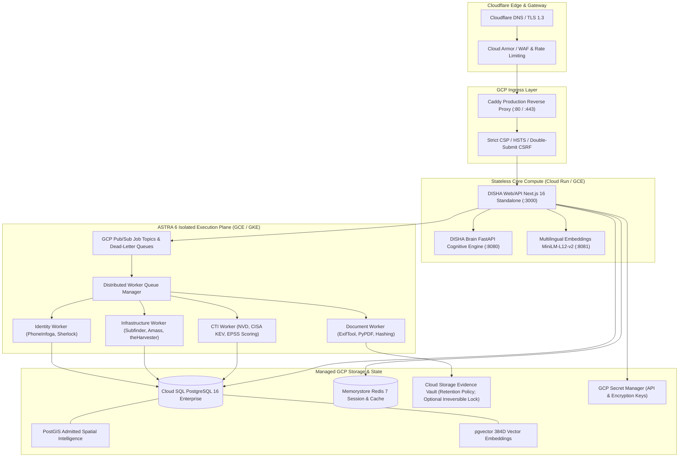

# DISHA 6.6
### Constitutional Evidence Operating System & Sovereign Defense Intelligence Platform

[](https://github.com/Tashima-Tarsh/Disha6.6/actions/workflows/ci.yml)
[](https://github.com/Tashima-Tarsh/Disha6.6/actions/workflows/db-migrations.yml)
[](https://cloud.google.com)
[-000000?logo=nextdotjs&logoColor=white)](https://nextjs.org)
[](https://www.postgresql.org)
[](https://threejs.org)
[-red)](https://github.com/Tashima-Tarsh/Disha6.6)

---

## Executive Overview

**DISHA 6.6** (Defense Intelligence & Sovereign Homeland Analytics) is an evidence-governed intelligence operating system for public-source research, cyber-defense analysis, provenance review, and policy-controlled agent workflows.

DISHA operates as **one unified intelligence operating system**:
* **Public OSINT & Infrastructure Reconnaissance:** Authoritative multi-source intelligence gathering across passive DNS, RDAP, Certificate Transparency, and public repositories.
* **Cyber Threat Intelligence (CTI) & Attack Surface Defense:** Dynamic attack surface asset mapping, technology fingerprinting, CVE-to-CISA-KEV exploit correlation, and look-alike domain protection.
* **Constitutional Contradiction & Corroboration Engine:** Automated detection of statement vs. statement conflicts, gazette-to-action discrepancies, and independent source family validation.
* **Astra 6 3D Gateway & OSINT Universe:** Full-screen WebGL login gateway plus an authenticated source universe whose planets are bound to declared OSINT sources, connector modes, runtime health, and live evidence.
* **No Synthetic Operational Intelligence & Cryptographic Provenance:** Production intelligence APIs fail closed when required persistence is unavailable; admitted evidence events use a tamper-evident SHA-256 append-only hash chain.

```
OPERATIONAL DATA CHAIN:
Public Source Observation ──► Universal Target Classifier ──► Constitutional Policy Gate ──► Governed Adapter / Worker Bus ──► SHA-256 Evidence Ledger & Vault ──► Human Review
```

---

## 3D Spatial Gateway & OSINT Universe

The login route uses a capability-only Three.js scene. Before authentication it shows architecture concepts such as Public Sources, Policy Gate, Evidence Ledger, Intelligence Graph, Universal Search, and ASTRA Workers; it does **not** present synthetic operational targets or telemetry.

After authentication, `/universe` renders the governed OSINT source catalog as a navigable planetary system:

- **Builtin planets** represent executable public/passive adapters and expose current adapter health.
- **Connector-ready / requires-configuration planets** remain visible but are clearly marked until credentials, licensing, or deployment configuration is present.
- **Reference-only planets** are discovery resources and are never presented as live integrations.
- **Blocked-by-default planets** identify sources whose data or usage needs separate legal/policy review.
- **Gold live-result planets** are created only from evidence returned by a live governed search and carry a source reference plus SHA-256 provenance hash.
- **Deep ASTRA** is available for supported passive infrastructure targets as a durable worker job; long-running jobs are polled by run ID rather than simulated synchronously.

The scene supports drag rotation, zoom, source/category filtering, connector inspection, and evidence selection. The frontend consumes the same authenticated `/api/v1/osint/*` control plane used by non-visual clients.

---

## GCP Production Architecture

DISHA 6.6 is deployed on a decoupled, high-resilience Google Cloud Platform infrastructure in the `asia-south1` (Mumbai) region:



---

## Integrated Operational Surfaces

| Surface | Route | Operational Function |
| :--- | :--- | :--- |
| **Astra 6 Spatial Login** | `/login` | Capability-only 3D WebGL gateway with password or configured OIDC/PKCE identity providers and signed sessions. |
| **OSINT Universe** | `/universe` | 3D source/connector universe, runtime health, universal live search, evidence planets, and durable Deep ASTRA runs. |
| **Mission Command** | `/` | Central authenticated mission surface. |
| **Dashboard** | `/dashboard` | Governed operational summaries sourced from admitted records. |
| **Intelligence Workspace** | `/intelligence` | Entities, temporal graph, reviews, evidence lineage, and live intelligence state. |
| **Mission Workbench** | `/workbench` | Policy-gated mission and agent workflows. |
| **Cyber Defense Engine** | `/cyber-defense` | Defensive attack-surface, vulnerability-priority, and secret-exposure analysis. |
| **Contradiction Center** | `/contradictions` | Claim conflicts, temporal/unit/definition divergence, and review gates. |
| **Corroboration Engine** | `/corroboration` | Independent-source-family corroboration and anti-syndication analysis. |
| **Evidence Vault** | `/vault` | SHA-256 content integrity, version lineage, and non-destructive evidence history. |
| **Public OSINT Workspace** | `/surveillance` | Governed source catalog, public/passive search, reference visualization, and evidence event stream. |
| **System Status** | `/system` | Production/readiness and runtime status surfaces. |

---

## ASTRA 6 CLI Execution Plane

To ensure maximum security and stability, CLI-heavy tools are executed outside the Next.js process boundary in dedicated, hardened worker containers:

* **Identity OSINT Worker:** `PhoneInfoga` (v2.11.0), `Sherlock` (v0.15.0) — dispatch requires an authorized operator/admin context **and** explicit deployment approval; it is not exposed through the ordinary universal-search path.
* **Infrastructure OSINT Worker:** `ProjectDiscovery Subfinder` (v2.6.6), `OWASP Amass` (v4.2.0 passive), `theHarvester` (v4.6.0 passive).
* **Document Intelligence Worker:** `ExifTool` (v12.76), `PyPDF`, SHA-256 / SHA-512 cryptographic hashing.
* **Cyber Threat Intelligence Worker:** MITRE CVE, CISA KEV (Known Exploited Vulnerabilities), FIRST EPSS scoring models.

### Execution Security Directives
* Every worker executes under **least-privilege non-root** service accounts (`uid 10001`).
* **Zero shell command concatenation:** All processes invoked via `execFile(binary, args[])` with strict regex argument guards.
* Workers run as unprivileged users; deployment-specific container/VM hardening remains part of the production environment.
* Durable workflow queues use leases, heartbeats, retry backoff, and dead-letter state; ASTRA connector runs are persisted separately and exposed by run ID.

---

## Production Verification & Quality Gates

The active product has automated lint, strict TypeScript type-checking, Vitest, Next.js production build, standalone-artifact, and database-migration verification. Production claims follow these rules:

* **No synthetic operational intelligence:** runtime intelligence/geospatial endpoints return empty/unconfigured states when required persistence is unavailable rather than inventing entities, events, counts, hashes, or telemetry.
* **Evidence truthfulness:** the ledger is a SHA-256 append-only hash chain; the artifact vault uses SHA-256 content integrity and version lineage. It is not described as a Merkle tree.
* **Storage retention:** the GCP evidence bucket has a configurable retention policy. Irreversible retention locking is an explicit production deployment decision (`evidence_retention_lock=true`), not an assumed default.
* **Changed-line governance:** CI rejects newly introduced debt markers and selected unsafe workflow patterns in changed lines.
* **Human verification:** model/agent output remains advisory; policy and review controls prevent automated promotion of unsupported claims to verified truth.
* **Deployment verification still matters:** OIDC/MFA configuration, KMS/secrets, HA/backup restore, observability, load/chaos testing, penetration testing, prompt-injection testing, and disaster-recovery exercises must be validated in the target environment.

---

## License & Sovereign Notice

DISHA 6.6 is engineered under strict Constitutional No-First-Use (NFU) defensive doctrines. All modules adhere to sovereign security controls and statutory data preservation directives.
