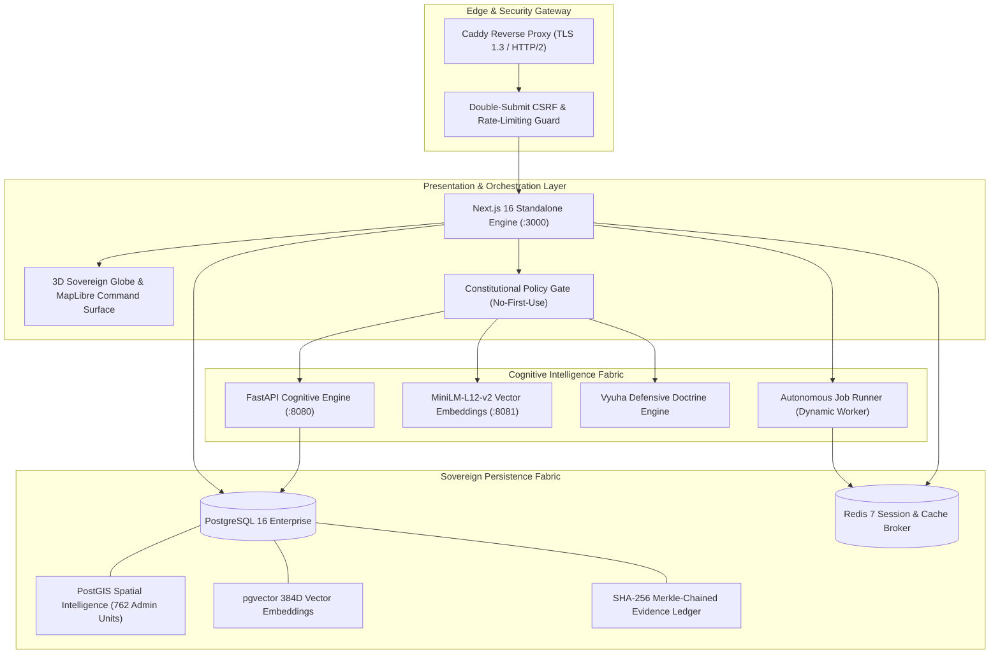

# DISHA 6.6

**Sovereign Cognitive Intelligence & Constitutional Defense Operating System**

[](https://github.com/Tashima-Tarsh/Disha6.6/actions/workflows/ci.yml)
[](https://github.com/Tashima-Tarsh/Disha6.6/actions/workflows/db-migrations.yml)
[](https://github.com/Tashima-Tarsh/Disha6.6/actions/workflows/codeql.yml)


---

## Executive Overview

**DISHA 6.6** (Defense Intelligence & Sovereign Homeland Analytics) is an enterprise-grade cognitive operating system engineered for national security analysts, critical infrastructure defenders, and command authorities.

DISHA 6.6 enforces an uncompromising **Zero-Mock Policy**: every displayed telemetry coordinate, threat indicator, graph edge, and spatial district is bound to authoritative PostGIS geometries, real-time public passive network sensors (DNS, RDAP, CT logs), and a tamper-evident SHA-256 cryptographic evidence ledger.

```
OPERATIONAL DATA CHAIN:
Public Sensor Intercept ──► Canonical Normalization ──► Constitutional Policy Gate ──► Sovereign Fusion Lenses ──► SHA-256 Cryptographic Ledger ──► Command Review
```

---

## System Architecture

DISHA 6.6 is engineered as a resilient, containerized multi-tier service fabric deployed on hardened Google Cloud Platform infrastructure.



### Core Microservices

| Service | Technology | Port | Operational Scope |
| :--- | :--- | :--- | :--- |
| **`caddy`** | Caddy v2 Alpine | `80`, `443` | Reverse proxy, automated TLS termination, security header enforcement. |
| **`web`** | Next.js 16, React 19, TypeScript | `3000` | Command dashboard, workbench, surveillance deck, intelligence review, RBAC. |
| **`disha-brain`** | Python 3.11, FastAPI, Uvicorn | `8080` | Multi-lens cognitive analysis, threat graph fusion, reasoning engine. |
| **`embeddings`** | PyTorch, Sentence-Transformers | `8081` | Sovereign multilingual vector embeddings (`MiniLM-L12-v2`, 384 dimensions). |
| **`dynamic-worker`** | Node.js 22 LTS Runtime | Internal | Background task execution, OSINT sensor polling, evidence ledger maintenance. |
| **`postgres`** | PostgreSQL 16 + PostGIS + pgvector | `5432` | Relational storage, geospatial spatial indexes, vector similarity search. |
| **`redis`** | Redis 7 Alpine | `6379` | High-throughput in-memory job queues, session caching, distributed locks. |

---

## Core Operational Capabilities

### 1. Vyuha Cyber Defense & Constitutional Policy Gate
Operating under a strict **No-First-Use (NFU)** defensive doctrine, the Vyuha Defense Engine plans defensive containment, decoy network topologies, and honeypot sensor deployments:
- **Zero Offensive Action**: Algorithmic policy gate strictly denies offensive payloads, exploit generation, brute-forcing, and destructive network operations.
- **Defensive Formations**: Algorithmic tactical postures (*Kurma*, *Chakra*, *Padma*, *Trishula*) mapped to MITRE ATT&CK mitigation frameworks.
- **Mandatory Confirmation**: Any automated mitigation with operational impact automatically pauses execution in `waiting_for_confirmation` status until authorized by a credentialed operator.

### 2. Cryptographic SHA-256 Evidence Ledger
Every cognitive mission, human analysis, policy evaluation, and intelligence query produces an immutable evidence event:
- **Merkle-Chained Provenance**: Each record includes `payloadHash = SHA256(canonicalJson(payload))` and `eventHash = SHA256(payloadHash : previousHash)`.
- **Zero Drift**: PostgreSQL persistence ensures bit-for-bit canonical serialization, eliminating hash divergence across storage and transit.
- **Audit Verification**: Full chain integrity verifiable on demand via `/api/evidence/verify` or exportable as sealed evidence reports via `/api/evidence/export`.

### 3. Sovereign PostGIS Geospatial Intelligence
Integrated GIS command center backed by native PostGIS spatial queries:
- **National Cartographic Boundaries**: Full national boundary coordinate system imported and validated under WGS-84 (SRID 4326).
- **Official District Geometries**: 759 Indian administrative districts with verified 95.4% Local Government Directory (LGD) census mapping.
- **Critical Infrastructure Topologies**: Spatial mapping of national energy grids, satellite ground stations, defense laboratories, and submarine cable landing points.

### 4. Governed Passive OSINT Search Engine
Real-time open-source intelligence aggregation pipeline:
- **Direct Protocol Adapters**: Live passive queries to official DNS records, RDAP registry lookups, and Certificate Transparency (CT) logs.
- **Compliance Filter**: Excludes private databases, stolen credentials, and active intrusive scanning by default.
- **Entity Resolution**: Multi-domain relationship mapping linking autonomous system numbers (ASNs), IP ranges, SSL identities, and domain registries.

### 5. ASTRA 6 — Governed Six-Tool OSINT Fabric
Enterprise orchestration of authoritative open-source intelligence frameworks under strict constitutional governance:

| Tool | Capability & Scope | Execution Class | Governance & Policy Gate |
| :--- | :--- | :--- | :--- |
| **PhoneInfoga** | Phone number validation, carrier lookup, reputation analysis | `passive_public` | Identity investigation policy gate; blocks harassment & unauthorized surveillance |
| **Sherlock** | Username presence discovery across 400+ public platforms | `passive_public` | Authorized identity investigation gate (`DISHA_IDENTITY_ENUMERATION_APPROVED`) |
| **theHarvester** | Passive domain intelligence, email harvesting, DNS discovery | `passive_public` | Passive allowlist (Anubis, crt.sh, DNSDumpster, HackerTarget, OTX, RapidDNS); active engines blocked |
| **SpiderFoot** | Multi-source OSINT correlation & attack surface analysis | `passive_public` | 34 reviewed passive modules allowlisted; port scanning & active crawlers strictly blocked |
| **OWASP Amass** | Attack surface mapping & asset discovery | `passive_public` | Passive-only mode enforced (`-passive` flag); DNS brute-forcing & zone transfers denied |
| **Subfinder** | High-speed passive subdomain enumeration | `passive_public` | Multi-source passive discovery; active probing & port scanning blocked |

- **Command Injection Immunity**: All CLI inputs validated against strict shell metacharacter rejection guards (`SHELL_INJECTION_GUARD`) prior to worker dispatch.
- **Dedicated Persistence**: Backed by `astra6_tool_manifests`, `astra6_connector_health`, `astra6_connector_runs`, `astra6_observations`, and `astra6_entities` with PostgreSQL Row-Level Security (RLS).
- **Automated Target Classification**: DISHA autonomously classifies inputs (domain, IP, email, phone, username) and routes to optimal tools without requiring manual tool selection.


---

## Primary Command Interfaces

| Command View | Route | Operational Functionality |
| :--- | :--- | :--- |
| **National Command Center** | `/dashboard` | Sovereign posture overview, threat radar, active mission counts, critical infrastructure status. |
| **Surveillance Deck** | `/surveillance` | Real-time sensor feed monitoring, live OSINT search queries, Vyuha defense posture evaluations. |
| **Mission Workbench** | `/workbench` | Structured multi-lens analysis execution, policy gates, hypothesis evaluation, evidence export. |
| **Intelligence Review** | `/intelligence` | Watch bundles, indicator tracking, analyst review queue, cryptographic evidence timeline. |
| **System Health** | `/system` | Microservice heartbeat monitoring, database connection pool statistics, Redis metrics. |
| **Identity Gateway** | `/login` | High-security authenticated access with Argon2 password hashing and signed JWT session rotation. |

---

## Production Deployment (Google Cloud Platform)

DISHA 6.6 is engineered for native deployment on Google Cloud Platform (GCE / GKE / Cloud Run).

### Production Topology on GCP Compute Engine

```
GCP Region: asia-south1 (Mumbai)
Compute: GCE e2-standard-4 (4 vCPUs, 16 GB RAM)
Storage: 100 GB Persistent SSD (pd-ssd)
Operating System: Ubuntu 24.04 LTS Hardened Minimal
Firewall Rules: Ingress TCP 80, 443 (HTTP/HTTPS), SSH via IAP (Identity-Aware Proxy)
```

### Automated Deployment Runbook

```bash
# 1. Clone repository to deployment host
git clone https://github.com/Tashima-Tarsh/Disha6.6.git /opt/disha
cd /opt/disha

# 2. Configure production secrets
cp .env.example .env.production
# Populate POSTGRES_PASSWORD, DISHA_JWT_SECRET, DISHA_BRAIN_API_TOKEN, DISHA_WORKER_TOKEN

# 3. Execute automated GCP deployment script
bash infra/gcp/deploy-remote.sh

# 4. Verify running services
docker compose -f docker-compose.gcp.yml ps
```

---

## Security & Hardening Controls

- **Double-Submit CSRF Defense**: Enforces strict matching between client-accessible `disha_csrf` cookie and `x-csrf-token` header on all mutating requests (POST, PUT, DELETE).
- **Strict Content Security Policy (CSP)**: Default `frame-ancestors 'none'`, prohibiting clickjacking and embedding across external origins.
- **Role-Based Access Control (RBAC)**: Strict role demarcation (`admin`, `operator`, `analyst`, `viewer`) controlling access to mission initiation, evidence export, and system configuration.
- **Rate-Limiting & Abuse Prevention**: Token bucket rate limiter preventing brute-force authentication and denial-of-service attempts.
- **Immutable Audit Logging**: Every administrative action, authentication attempt, and policy decision recorded permanently in PostgreSQL `audit_events`.

---

## Continuous Integration & Quality Assurance

Every commit is validated through automated GitHub Actions pipelines:

| Pipeline | Trigger | Verification Stages |
| :--- | :--- | :--- |
| **`disha6.6 Product CI`** | Push to `main`, Pull Requests | Governance policy check, dependency vulnerability audit, ESLint, TypeScript static analysis, Vitest component test suites, Next.js 16 production build. |
| **`disha6.6 Database Migrations`** | Push to `main`, Pull Requests | Containerized PostgreSQL 16 + PostGIS rehearsal, migration apply, schema verification, rollback rehearsal, production Compose validation. |
| **`CodeQL Advanced`** | Push to `main`, Pull Requests, Weekly | Deep semantic static analysis scanning for vulnerabilities across TypeScript, Python, and Go modules. |

---

## Enterprise Support & Governance

DISHA 6.6 is built strictly for authorized intelligence, defense analysis, and critical infrastructure protection workflows.

- **Security Advisories**: Report potential vulnerabilities through GitHub Private Vulnerability Reporting or via `SECURITY.md`.
- **License**: UNLICENSED. All rights reserved. Redistribution, commercial use, or unapproved deployments are strictly prohibited without authorization.
