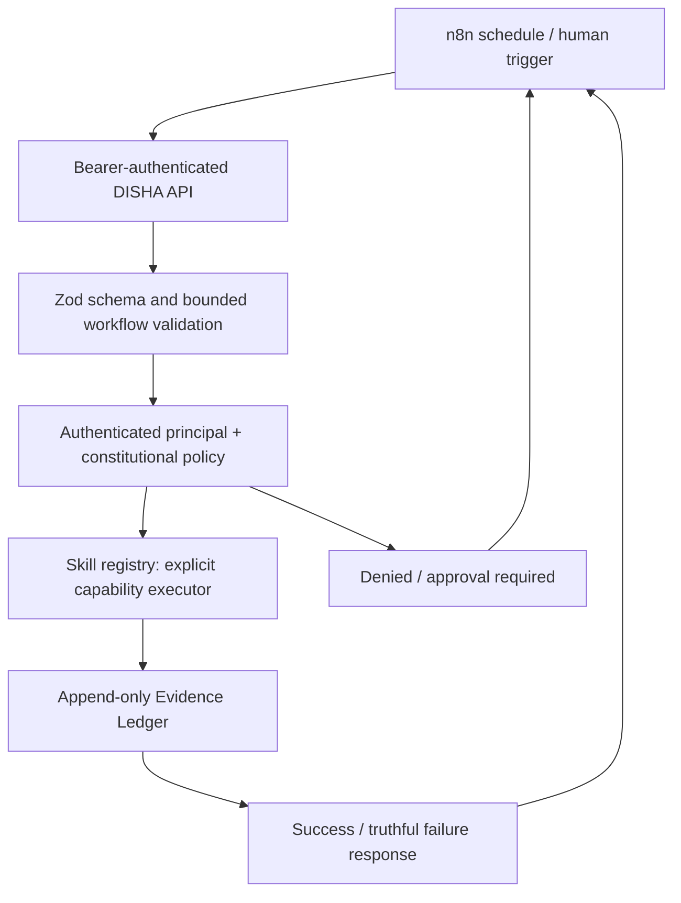

# DISHA6.6 — Governed Skill Orchestration

This document describes the **implemented** n8n-to-DISHA skill bridge and distinguishes indexed
instructions from actual tool execution. It does **not** claim that every one of the 1,806 skills
has an independent executor.

## Working architectural contract



- n8n orchestrates **when** tasks run and routes outcomes.
- DISHA decides **whether** each task is permitted and what the executor actually did.
- `POST /api/v1/workflows/n8n/skills` runs one to eight ordered, explicitly registered skill
  steps. The route uses the signed caller principal, not a caller-provided actor field.
- Steps may declare `dependsOn` for earlier step IDs. Failure, unsupported capability,
  missing authorization, or absent result evidence prevents subsequent execution.
- A fresh server-generated `missionId` links all step events with a final workflow event.
- A workflow is `COMPLETED` only if every step returns `SUCCESS` **and an evidence ID**.
  If a step fails, the response is HTTP 422 with `workflowStatus: STOPPED`.
  If the final evidence append fails, the endpoint returns HTTP 503.
- Retries are currently **at-least-once**, not idempotent. n8n should not automatically retry
  potentially mutating jobs until durable idempotency and explicit approval are implemented.
- The endpoint does **not** accept arbitrary scripts, hostnames for scanning, or runnable shell commands.

## Request example

With a valid DISHA Bearer token belonging to an account allowed to run agents:

```http
POST /api/v1/workflows/n8n/skills
Authorization: Bearer <authenticated-DISHA-access-token>
Content-Type: application/json

{
  "correlationId": "research-batch-2026-10-25",
  "steps": [
    {
      "id": "hyperparameters",
      "skillId": "aeo",
      "taskPrompt": "Validate the supplied offline model configuration",
      "params": {"learningRate": 0.0003, "batchSize": 32, "layers": 4, "hiddenDim": 256}
    },
    {
      "id": "statistics",
      "skillId": "agent-accelerator-physicist",
      "taskPrompt": "Calculate descriptive statistics for these measurements",
      "dependsOn": ["hyperparameters"],
      "params": {"data": [10.2, 11.5, 9.8, 12.1]}
    }
  ]
}
```

**Sample IDs are current catalog examples, not promises of independent model training or
accelerator physics expertise.** In this example, the registered categories delegate to
offline hyperparameter and descriptive statistics validators respectively.

Response shape:

```json
{
  "workflow": "disha-governed-skills",
  "workflowStatus": "COMPLETED",
  "missionId": "n8n-skills-<server-generated-uuid>",
  "correlationId": "research-batch-2026-10-25",
  "workflowEvidenceId": "<ledger-event-id>",
  "results": [
    {"id": "hyperparameters", "skillId": "aeo", "status": "SUCCESS", "summary": "...", "evidenceId": "...", "artifactHash": "..."},
    {"id": "statistics", "skillId": "agent-accelerator-physicist", "status": "SUCCESS", "summary": "...", "evidenceId": "...", "artifactHash": "..."}
  ]
}
```

## Import into n8n

1. Obtain an authenticated DISHA session/token and securely configure n8n's HTTP Header Auth
   credential: `Authorization: Bearer <token>`. Do not save credentials inside workflow JSON.
2. Set `DISHA_BASE_URL` to the **network-reachable** web-app origin; inside Docker networks
   this is generally the service hostname, not `localhost`.
3. Authenticated `GET /api/v1/workflows/n8n/schemas` exports
   `governedSkillWorkflow` alongside the legacy event template. Import the
   `governedSkillWorkflow` object into n8n and attach the credential to the HTTP node.
4. Send the JSON request above to the n8n webhook path `disha-governed-skills`.
5. Configure the HTTP node to retain error responses for HTTP 4xx/5xx, and branch on
   `workflowStatus`. Escalate refusals to a human; never silently retry them.

## Capability tiers — no false success

| Tier | Meaning | Reporting rule |
| --- | --- | --- |
| Catalogued | `SKILL.md` found and indexed | Never say executed |
| Offline validated | A deterministic validator used supplied inputs | Describe only measurements actually made |
| Governed adapter | Adapter invoked with verified target scope | Require its execution receipt |
| Autonomous role | Model/tool runtime performed actual bounded steps | Require trace, receipts, and proof of work |
| Verified evidence | Human-approved, provenance-backed finding | Not conferred by an LLM or role persona |

As of this change, general, frontend, and OSINT informational skills without an independent
executor return `NOT_EXECUTED` instead of `SUCCESS`. Network input consistency checks
must not claim real packet flow or routing convergence. Role personas that only load
instructions return `NOT_EXECUTED`.

## Defensive operating modes

1. **Passive research:** official/public advisories, DNS/certificate metadata and
   OSINT sources with lawful provenance; no credential dumps.
2. **Authorized assessments:** administrative asset inventory or signed, expiring grants
   bound to scope, tool, operator and target. Rate-limit and record tool receipts.
3. **Deception / honeypots:** isolated, owned infrastructure; ingest redacted attacker
   observations; never use a honeypot as authorization to intrude back into source systems.
4. **Vyuha response:** model containment, isolation, monitoring, blocking and recovery as
   reviewable proposals; enact only preapproved measures on owned assets.
5. **Research:** require input datasets, reproducibility info, statistics/model outputs
   and independent review before saying a scientific conclusion is verified.

## Repository integration inventory

The audited tracked-file tree contains **no Supabase-named paths**. Render and Netlify
appear primarily in optional skill packs for deployment; these are not required by the
production web app. Removing an optional skill pack should be a separate, reversible
change after a manifest/usage/license review; do not delete the canonical role registry
or bundled third-party licenses just to reduce the file count.

The repository includes n8n webhook/schema routes, Vyuha rules, an OSINT backend and
honeypot configurations. Their existence alone does not establish running services or
complete orchestration. The code in this PR bridges **registered skills only**.

## Next production milestones

- A capability manifest per skill with `executorId`, `availability`, `inputSchema`,
  `outputSchema`, `riskLevel`, and explicit `scopeRequirements`.
- True adapter invocation receipts from approved OSINT, scientific toolchains,
  code linters/AST parsers and model-evaluation runners.
- Durable n8n idempotency keys, step attempts/leases, retry budgets, cancellation and
  policy-aware compensation.
- Signed evidence-chain verification, source provenance and human review.
- Lab-only integration tests for owned assets and honeypot telemetry; prohibit
  unauthorized scanning or retaliatory exploitation.
- CI matrix with skill categories, contract tests, workflow integration, network-denial
  negative tests and a production image smoke test that verifies `.agents` asset availability.

## Local verification

```bash
cd web
npm ci
npm test -- --run tests/n8n-governed-skills.test.ts tests/n8n-workflow-bridge.test.ts tests/skill-registry.test.ts
npm run type-check:full
npm run build
```

These commands are the **required checks**, not a claim they were run during this remote
change. The GitHub branch should be merged only after CI and reviewer approval.
