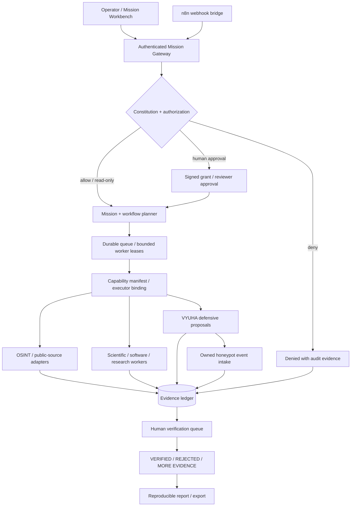

# DISHA 6.6 — Unified Mission & Orchestration Architecture

> **Status:** engineering blueprint. This document distinguishes implemented foundations from proposed integration work. It does not imply that every indexed skill, agent, OSINT collector, n8n workflow, or VYUHA action is executable today.

## Architectural objective

One user-authorized mission can invoke multiple research, public-source intelligence, scientific, software, and defensive security capabilities, with a common runtime identity, authorization scope, state machine, evidence record, and human review pathway.

The canonical intelligence path is:

```text
Mission request → Authentication + scope → Constitutional policy
   → Planner / workflow dispatcher → Governed skill / adapter workers
   → EvidenceEvent normalization → Hash-chained ledger
   → Correlation + verification queue → Human review → Report
```

### Logical architecture



## Implemented versus target

| Plane | Present in repository | Still required |
|---|---|---|
| Constitutional contracts | `packages/contracts`, `CONSTITUTION.md` | Unified adoption across all execution surfaces |
| Mission and review | `packages/mission`, `packages/review`, `packages/orchestrator` | All workers use one mission identity and human review boundary |
| Evidence | `packages/evidence-ledger`, `web/lib/unified/evidence-ledger.ts` | End-to-end durable-chain consistency and restore tests |
| Adapter bus | `packages/adapter-bus`, `packages/adapters`, `backend/` | Per-adapter environment health, rate limits, source authorization |
| Skills | `web/lib/skills/skill-registry.ts`, `web/data/skills/skills-index.json` | Executor bindings for each advertised executable capability |
| Expert roles | `web/data/skills/roles-index.json` | Actual agent/worker calls and verifiable output, not synthetic success |
| n8n | `web/app/api/v1/workflows/n8n/` | Authenticated callbacks, replay protection, state reconciliation |
| Workflows | `web/lib/unified/workflow-executor.ts` | General DAG executor, bounded concurrency, checkpoints and cancellation |
| VYUHA | `skills/vyuha-defense-engine/`, `web/lib/extensions/vyuha-defense.ts` | Authorized live defensive action executor with rollback |
| Honeypots | `web/lib/extensions/honeypot-evidence.ts` | Verified sensor enrollment and owned-lab deployment lifecycle |

## Dynamic skill orchestration design

**Catalog registration is not execution.** DISHA has 1,806 skill index entries and 503 role definitions at the inspected 25 October 2026 revision. A skill is operational only when it passes a genuine integration test against a bound executor.

```json
{
  "schemaVersion": "disha.capability.v1",
  "id": "public-domain-dns",
  "executionMode": "passive",
  "executor": "dns-lookup",
  "inputSchema": "schemas/dns-input.json",
  "outputSchema": "schemas/observation.json",
  "permissions": ["agent:run", "source:public"],
  "requiresApproval": false,
  "timeoutMs": 15000,
  "emitsEvidence": true,
  "smokeTest": "tests/integration/dns-adapter.test.ts"
}
```

*This manifest is a proposal, not an existing config file.*

A registered skill should expose two distinct states:

- **Capability readiness:** `CATALOGUED`, `BINDING_VALIDATED`, `READY`, `SMOKE_PASSED`, `PRODUCTION_READY`, `BLOCKED`.
- **Job execution:** `QUEUED`, `WAITING_APPROVAL`, `RUNNING`, `SUCCEEDED`, `PARTIAL`, `FAILED`, `POLICY_DENIED`, `TIMED_OUT`, `NOT_EXECUTED`.

A prompt loaded, persona assigned, or instruction summarized **must never report real task execution as `SUCCEEDED`**.

### Workflow and event contract

Every dispatched work item requires `missionId`, `jobId`, authenticated principal, `capabilityId`, scope reference, input digest, output schema version, idempotency key, retry/timeout budget, and evidence event IDs. Persist failure, denial, and partial execution rather than silently producing successful-looking fallbacks.

Workers should be isolated by permission and network class. All outbound data collection and authorized scanning should pass through the governed adapter boundary, not arbitrary LLM-generated shell commands.

## n8n-style workflow plane

The existing routes are:

- `POST /api/v1/workflows/n8n/webhook` — schema-constrained incoming events.
- `GET /api/v1/workflows/n8n/schemas` — starter n8n workflow template.
- `web/lib/unified/workflow-executor.ts` — durable processing of selected background workflows.

**Target flow:**

```text
n8n Trigger → DISHA authenticated gateway → Scope / policy check
           → Queue mission → Real executor(s) → Evidence
           → Human review (where required) → Signed status callback → n8n
```

Production prerequisites: scoped n8n credentials, signed and replay-protected webhooks, execution IDs, idempotency, status endpoints, retry semantics, and end-to-end integration tests.

## YUDH / VYUHA and “Attack the Attack”

These are **defensive response doctrines**:

- **Detect:** ingest approved sensor, alert, and honeypot events.
- **Understand:** correlate observations with evidence and confidence.
- **Form a posture:** select a VYUHA defensive formation.
- **Contain:** optionally rate-limit, block, isolate, or revoke on infrastructure the operator controls.
- **Verify:** measure response effectiveness and preserve audit evidence.
- **Recover:** use controlled rollback, restore services, and perform human review.

Retaliatory hacking, unauthorized access, unrestricted internet scanning, acquisition of leaked credentials, and destructive operations against external systems are excluded by the repository's existing Constitution and No-First-Use model.

The current web VYUHA extension produces *proposals*; honeypot support ingests *owned-environment events*. Both require significant implementation work to become live orchestration components.

## Release acceptance criteria

- [ ] Fast CI and E2E all green on the same commit.
- [ ] No prompt-only skills or synthetic expert-role completions reported as successful execution.
- [ ] Authenticated principal and authorization grant propagated into every executor.
- [ ] Every result and error produces an evidence event or fails closed.
- [ ] Unreviewed adapter summaries cannot claim `VERIFIED`.
- [ ] n8n mission status callbacks work end to end with signed events.
- [ ] At least one two-skill real DAG workflow is replayable and auditable.
- [ ] VYUHA action is tested in an **owned isolated lab** with approval and rollback.
- [ ] No development credentials exposed in production deployments.
- [ ] Capability readiness is measured by dated smoke tests rather than catalog count.

## Implementation milestones

1. **CI and correctness:** fix lint/parse failures, remove false-success semantics, fix trusted principal propagation, and correct premature `VERIFIED` wording.
2. **Converge runtimes:** one typed capability manifest and mission/evidence contract across web, packages, and Python.
3. **Universal orchestration:** durable DAG queue, worker leases, isolation, retries, compensation, and checkpoints.
4. **Human governed integrations:** n8n callbacks and permission-aware workflow builder.
5. **Adaptive defense:** deployable owned-lab VYUHA controls, enrolled honeypots, rollback and measurement.
6. **Independent assurance:** security review, source provenance, operational SLOs, disaster recovery, and hardened release pipeline.

**Definition of done:** A workflow is *operational* only if it invokes real executors against permitted inputs, yields schema-valid outputs, records evidence and policy decisions, honors review states, and passes a reproducible integration test.