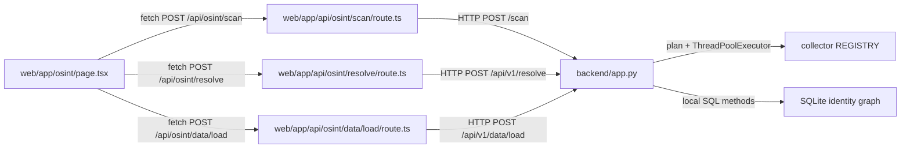
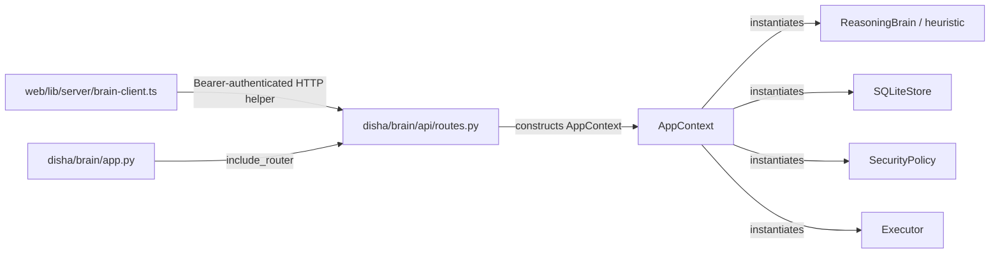
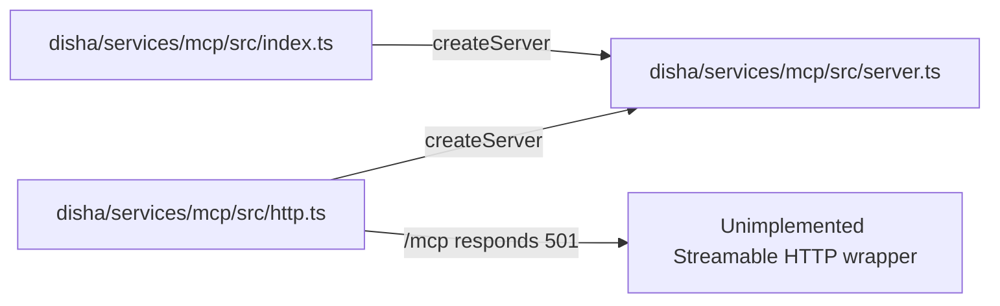

# Architecture overview (source-grounded, partial coverage)

> **Scope:** Traced entry points only, expanded with a subsequent targeted review of Yudh/Vyuha, Cognitive Engine, seven governed web extensions, three Brain analyzers, eleven AI-platform agents constructed in source, and the OSINT upstream catalogue. See [coverage](repository-coverage.md) and the [supplemental major-subsystem map](major-subsystems.md). The directed graph avoids describing file presence as runtime execution.

## Verified request paths

## Supplementary architecture map

The initial diagrams above focus on OSINT and Brain API paths. The additional source-grounded subsystem overview — including the **actual Brain Yudh/Vyuha invocation sequence**, three separate cognitive surfaces, web extension registration and multi-agent platform — is documented in [Major subsystems](major-subsystems.md). The [interactive 3D viewer](architecture-3d.html) and [machine-readable graph](architecture-graph.json) now include 53 component nodes with 52 individually referenced source relationships. These counts represent an **inspected subset**, not every module in the repository.

## Important boundaries

- **OSINT backend** is a separate FastAPI application from **Brain FastAPI**. They have different routing, middleware, and storage implementations. Do not merge their security assumptions.
- **Web authentication** in `web/lib/server/auth.ts` and **Brain token checks** in `disha/brain/security/auth.py` are distinct; the inspected OSINT proxy routes do not import `requirePrincipal`.
- **Internal module dependency versus network call:** a route importing a service proves static dependency; the browser-to-proxy-to-Python trace above has direct `fetch` evidence.
- **Heuristic versus model-backed:** `ReasoningBrain.create_plan()` directly invokes `_heuristic_plan()`; no provider invocation in that method.
- **MCP transport implementations:** STDIO and SSE share an Explorer server factory. The root `src/entrypoints/mcp.ts` is separate and may depend on missing root-level code; build not verified.

## Evidence index

| Relationship | Source line(s) |
| --- | --- |
| OSINT page → scan proxy | [`web/app/osint/page.tsx` L41–90](https://github.com/Tashima-Tarsh/Disha6.6/blob/main/web/app/osint/page.tsx#L41-L90) |
| Scan proxy → OSINT FastAPI | [`web/app/api/osint/scan/route.ts` L8–15](https://github.com/Tashima-Tarsh/Disha6.6/blob/main/web/app/api/osint/scan/route.ts#L8-L15) |
| OSINT scan → registry | [`backend/app.py` L781–798](https://github.com/Tashima-Tarsh/Disha6.6/blob/main/backend/app.py#L781-L798) |
| OSINT data ingestion | [`backend/app.py` L827–848](https://github.com/Tashima-Tarsh/Disha6.6/blob/main/backend/app.py#L827-L848) |
| Brain app → router | [`disha/brain/app.py` L5–25](https://github.com/Tashima-Tarsh/Disha6.6/blob/main/disha/brain/app.py#L5-L25) |
| Brain router → components | [`disha/brain/api/routes.py` L43–79](https://github.com/Tashima-Tarsh/Disha6.6/blob/main/disha/brain/api/routes.py#L43-L79) |
| Brain heuristic planning | [`disha/brain/brain/reasoning.py` L6–16](https://github.com/Tashima-Tarsh/Disha6.6/blob/main/disha/brain/brain/reasoning.py#L6-L16) |
| Explorer stdio and SSE → factory | [`index.ts` L1–11](https://github.com/Tashima-Tarsh/Disha6.6/blob/main/disha/services/mcp/src/index.ts#L1-L11), [`http.ts` L1–18](https://github.com/Tashima-Tarsh/Disha6.6/blob/main/disha/services/mcp/src/http.ts#L1-L18) |

See the [offline 3D source graph](architecture-3d.html) for focus, rotation, filter, and source details. It intentionally covers selected units only.
