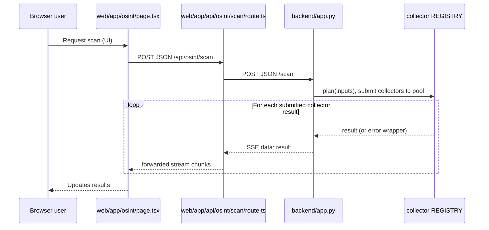
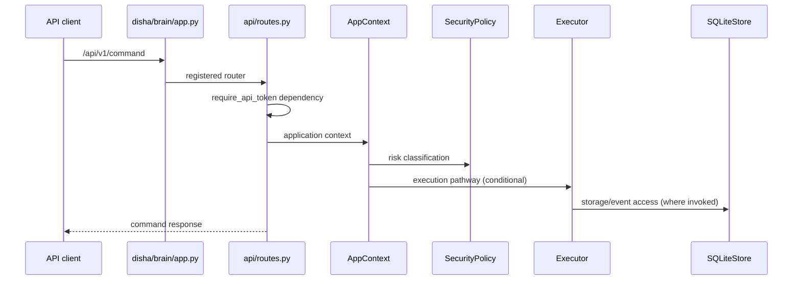
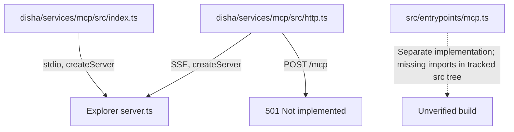

# Frontend, backend, data and execution flows

> Static reconstruction from inspected source only. No service was started.

## 1. OSINT scan stream — directly traced

Evidence: `web/app/osint/page.tsx:41-97`, `web/app/api/osint/scan/route.ts:8-36`, `backend/app.py:781-795`. The OSINT backend uses a thread pool for submitted work, but waits on futures in registration order in the streaming generator. That is not equivalent to delivering results in completion order. No runtime performance claim is made.

## 2. OSINT graph and dataset ingestion

- The UI calls `/api/osint/resolve` and `/api/osint/data/load` (`web/app/osint/page.tsx:98-127`).
- Next.js forwards to `backend/app.py` endpoints `/api/v1/resolve` and `/api/v1/data/load` respectively (proxy files and `backend/app.py:827-870`).
- `backend/app.py:700-748` implements a SQLite graph breadth-first traversal of identifiers, edges, facts, and breach hits.
- The Python service's local SQLite schema/persistence is **not** the same abstraction as `disha/brain/database/store.py`.

The content and provenance of datasets were **not** validated. This document does not approve ingestion of third-party personal information or expose instructions for acquiring illicit data.

## 3. Brain command path — source-level reconstruction

The sequence simplifies conditional branches; for precise behavior inspect `disha/brain/api/routes.py:415-477`. `AppContext` constructs `ReasoningBrain`, `Executor`, `MemoryBrain`, `RiskEngine`, `DecisionEngine` and `SQLiteStore` at module load (`routes.py:43-79`). A created object is not proof every operation is triggered on every request.

## 4. MCP entry points

Do not conflate static MCP tool-list definitions with working connector sessions.

## 5. Deployment/data architecture and runtime uncertainty

- `web/package.json` declares Next.js 16.3.6, React 19.3, `pg`, `redis`, and related dependencies.
- `disha/brain/requirements.txt` declares FastAPI, Pydantic, httpx, scikit-learn, and pytest.
- The repository tracks Docker/Compose manifests, Kubernetes configuration, SQL migrations, and infrastructure definitions. They were enumerated but **not audited or executed**.
- No claims are made about active production services, actual database instances, secrets, health or readiness of the integration fleet.
