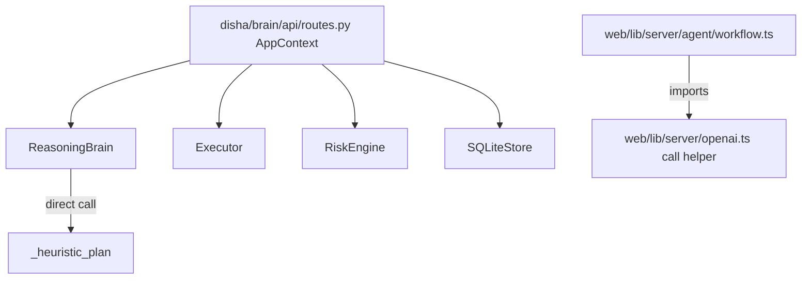

# AI and agent orchestration

> **Scope:** source-evidenced subset only; see [repository coverage](../repository-coverage.md). Static declarations are not proof of running services. Diagram nodes lacking source linkage are excluded.

The Brain `ReasoningBrain` is **deterministic** in the inspected code; the web workflow is separate and its call path was not traced. Do not interpret this as a connected end-to-end agent system.
