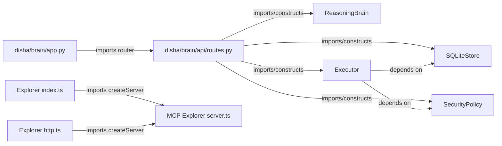

# Component dependencies

> **Scope:** source-evidenced subset only; see [repository coverage](../repository-coverage.md). Static declarations are not proof of running services. Diagram nodes lacking source linkage are excluded.

These are **imports/construction**, not network operations.
