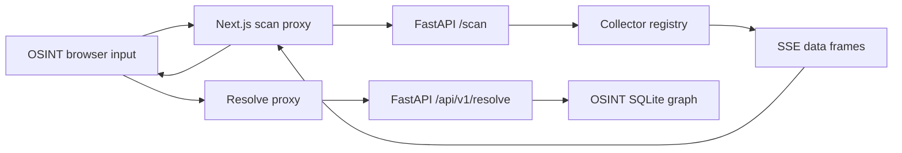

# Data-flow map

> **Scope:** source-evidenced subset only; see [repository coverage](../repository-coverage.md). Static declarations are not proof of running services. Diagram nodes lacking source linkage are excluded.

Return edges are response flow, not additional runtime services. The Python streaming loop waits on collector futures in plan order.
