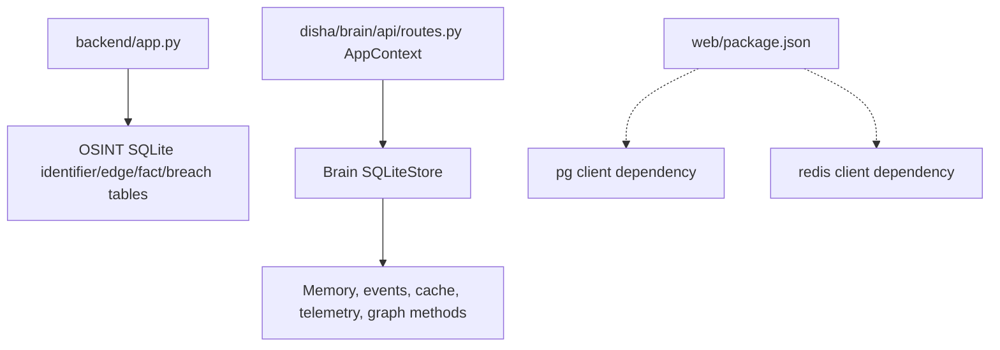

# Database and storage

> **Scope:** source-evidenced subset only; see [repository coverage](../repository-coverage.md). Static declarations are not proof of running services. Diagram nodes lacking source linkage are excluded.

Dashed lines are **manifest dependency declarations**, not established live network connections. A full SQL schema/migration audit was not performed. Two SQLite abstractions are independent in source.
