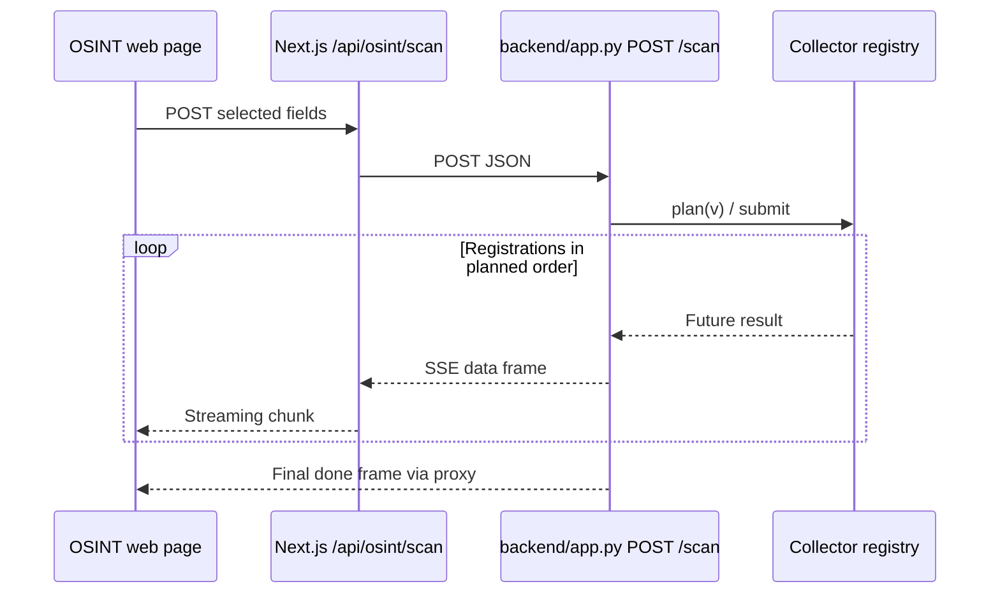

# Representative execution sequence

> **Scope:** source-evidenced subset only; see [repository coverage](../repository-coverage.md). Static declarations are not proof of running services. Diagram nodes lacking source linkage are excluded.

No runtime throughput, error rate or successful provider response has been verified.
