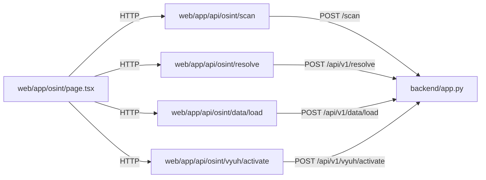

# Frontend ↔ backend

> **Scope:** source-evidenced subset only; see [repository coverage](../repository-coverage.md). Static declarations are not proof of running services. Diagram nodes lacking source linkage are excluded.

Authorization in these inspected proxy handlers is not visible; global middleware was not traced.
