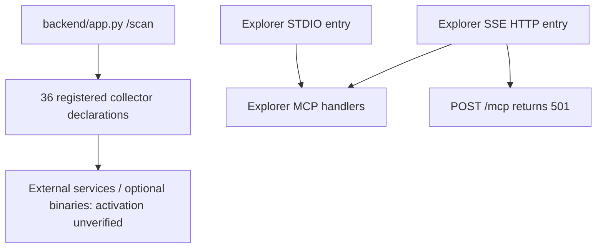

# Tools and integrations

> **Scope:** source-evidenced subset only; see [repository coverage](../repository-coverage.md). Static declarations are not proof of running services. Diagram nodes lacking source linkage are excluded.

Only collector registration and MCP handler wiring were inspected. No third-party endpoint or optional executable was tested. The integration tree contains 1,233 tracked files, **not** 1,233 verified integrations.
