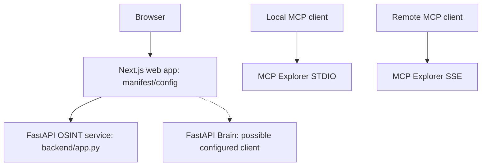

# Deployment and runtime model

> **Scope:** source-evidenced subset only; see [repository coverage](../repository-coverage.md). Static declarations are not proof of running services. Diagram nodes lacking source linkage are excluded.

**Not verified:** whether these services deploy together, production hostnames, Compose/Kubernetes routing, secrets, orchestration, health, or actual operational state. Lines describe source-level interaction templates only. The dashed Brain connection is a configurable helper, not a proven active caller.
