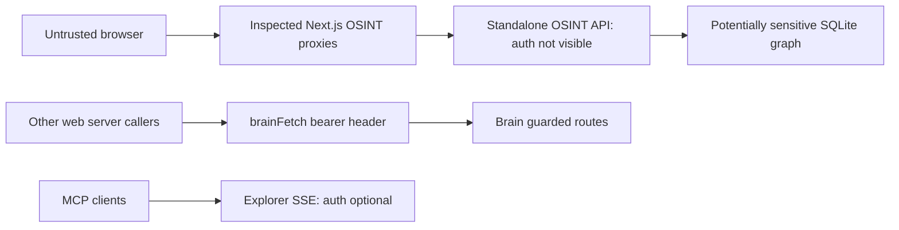

# Security and trust boundaries

> **Scope:** source-evidenced subset only; see [repository coverage](../repository-coverage.md). Static declarations are not proof of running services. Diagram nodes lacking source linkage are excluded.

This is an audit diagram, **not approval to expose any service**. See [security findings](../technical-audit.md).
