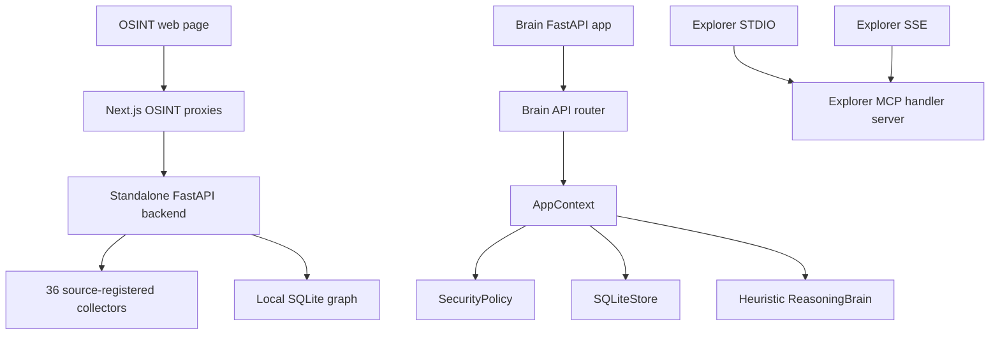

# System overview

> **Scope:** source-evidenced subset only; see [repository coverage](../repository-coverage.md). Static declarations are not proof of running services. Diagram nodes lacking source linkage are excluded.

The Brain and OSINT services have distinct entry points and stores. See [architecture overview](../architecture-overview.md).
