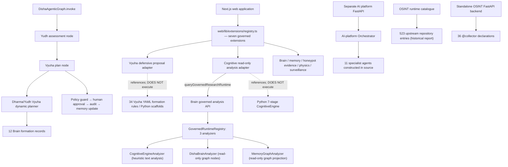

# DISHA 6.6 — Core subsystem map: Vyuha, Cognitive Engine, Brain, OSINT and more

> **Source-backed correction | 23 October 2026.** The earlier 34-file README investigation did not cover several important, actually tracked subsystems. This is a **supplemental targeted static review**; it does **not** certify all 5,782 current tracked files, all dependencies, all deployment paths, or full integration readiness. Source labels below distinguish **code present**, **registered**, **invoked in an inspected source path**, **scaffold**, **catalogued**, and **runtime unverified**. The original [audit coverage](repository-coverage.md) remains a historical snapshot taken before this extension.

## System map

**Reading the map:** Solid arrows trace inspected code imports, construction, invocation, or request dispatch; dotted arrows are deliberately **reference-only** (not execution paths). The main production deployment of the distinct backend services and historical OSINT status is unverified.

## 1. Yudh/Vyuha planning engine — actual Brain code

The [DishaAgenticGraph](https://github.com/Tashima-Tarsh/Disha6.6/blob/main/disha/brain/graph/graph.py) invokes these nodes in order: **intake → evidence → context → reasoning → version routing → action → Yudh → Vyuha → policy guard → human approval → audit → memory update**. Thus, Yudh and Vyuha are **wired into the graph's `invoke` method**, not merely mentioned in the design documentation.

- [`disha/brain/graph/nodes/yudh_agent.py`](https://github.com/Tashima-Tarsh/Disha6.6/blob/main/disha/brain/graph/nodes/yudh_agent.py) calls `assess_yudh()`, which creates a defensive posture, adversarial-risk category and lawful framing.
- [`disha/brain/graph/nodes/vyuha_agent.py`](https://github.com/Tashima-Tarsh/Disha6.6/blob/main/disha/brain/graph/nodes/vyuha_agent.py) invokes `build_dharma_yudh_vyuha_plan()` using state signals, risk, evidence class, confidence, links and requested actions.
- [`disha/brain/vyuha/dynamic.py`](https://github.com/Tashima-Tarsh/Disha6.6/blob/main/disha/brain/vyuha/dynamic.py) scores formations and returns permitted/forbidden actions, human-approval flags, evidentiary requirements and rationale.
- [`disha/brain/vyuha/formations.py`](https://github.com/Tashima-Tarsh/Disha6.6/blob/main/disha/brain/vyuha/formations.py) declares **12 Python formation records**: Nakshatra Mandala, Agni, Chakra, Padma, Sarpa, Shyena, Mandala, Sarvatobhadra, NYAYA Audit, SETU-VARUNA Resilience, HSE Equity and Gap Closure.
- [`disha/brain/graph/nodes/policy_guard_agent.py`](https://github.com/Tashima-Tarsh/Disha6.6/blob/main/disha/brain/graph/nodes/policy_guard_agent.py) evaluates requested actions and approval requirements.

**Separate Vyuha skill collection:** [`skills/vyuha-defense-engine/`](https://github.com/Tashima-Tarsh/Disha6.6/tree/main/skills/vyuha-defense-engine) contains **34 named `.yaml` formation-rule files**, plus one template, analyzers, Python orchestration code, audit hooks and tests. Its own README and `orchestrator/engine.py` describe an **incremental scaffold**; it is not evidence that every proposed defensive action can execute. The web [Vyuha extension](https://github.com/Tashima-Tarsh/Disha6.6/blob/main/web/lib/extensions/vyuha-defense.ts) explicitly says its adapter **only proposes actions**, and Python orchestration requires a separate execution-approval contract.

## 2. Cognitive Engine — three different implementation surfaces

| Layer | Source location | What inspected code proves |
| --- | --- | --- |
| Python seven-stage state machine | [`disha/ai/core/cognitive_loop.py`](https://github.com/Tashima-Tarsh/Disha6.6/blob/main/disha/ai/core/cognitive_loop.py) | `CognitiveEngine.process()` iterates `perceive → attend → reason → deliberate → act → reflect → consolidate`, catches/logs per-stage errors, records durations and returns state |
| Governed Brain analyzer | [`disha/brain/governed/cognitive_runtime.py`](https://github.com/Tashima-Tarsh/Disha6.6/blob/main/disha/brain/governed/cognitive_runtime.py) | `CognitiveEngineAnalyzer` performs **read-only, text-pattern-based** causal/uncertainty/negation/fact-candidate analysis. It is **not** the same class as the seven-stage Python engine |
| Web governed extension | [`web/lib/extensions/cognitive-engine.ts`](https://github.com/Tashima-Tarsh/Disha6.6/blob/main/web/lib/extensions/cognitive-engine.ts) | Registered read-only interpretation layer, requests source-bound observations. Its manifest states: **“The cognitive loop is not executed by this adapter.”** |

The Python cognitive loop imports memory management, hybrid reasoning, multi-agent deliberation, a decision engine, a goal engine, and a quantum-inspired decision helper. These are **source dependencies**, not evidence of verified AGI, general-purpose intelligence or calibrated physical quantum computation. The [existing seven-stage design narrative](internal/COGNITIVE_ENGINE.md) remains available but is not a runtime test report.

The Brain [`GovernedRuntimeRegistry`](https://github.com/Tashima-Tarsh/Disha6.6/blob/main/disha/brain/governed/runtime.py) registers **three distinct analyzers**: DISHA Brain, Cognitive Engine and Memory Graph. The Brain [`/api/v1/governed/analyze` endpoint](https://github.com/Tashima-Tarsh/Disha6.6/blob/main/disha/brain/api/routes.py) requires bearer authorization and read-only constraints in inspected source.

## 3. The seven registered web governed extensions

[`web/lib/extensions/registry.ts`](https://github.com/Tashima-Tarsh/Disha6.6/blob/main/web/lib/extensions/registry.ts) constructs a concrete registry of **seven** entries:

| Registered extension | Source | Scope from its manifest |
| --- | --- | --- |
| Vyuha Defense Engine | [`vyuha-defense.ts`](https://github.com/Tashima-Tarsh/Disha6.6/blob/main/web/lib/extensions/vyuha-defense.ts) | Defensive action **proposals**, approval/policy required |
| DISHA Brain | [`disha-brain.ts`](https://github.com/Tashima-Tarsh/Disha6.6/blob/main/web/lib/extensions/disha-brain.ts) | Read-only evidence-governed Brain analysis |
| Cognitive Engine | [`cognitive-engine.ts`](https://github.com/Tashima-Tarsh/Disha6.6/blob/main/web/lib/extensions/cognitive-engine.ts) | Read-only cognitive phase interpretation |
| Memory/Graph Layer | [`memory-graph.ts`](https://github.com/Tashima-Tarsh/Disha6.6/blob/main/web/lib/extensions/memory-graph.ts) | Source-bound memory and graph enrichment |
| Honeypot Evidence | [`honeypot-evidence.ts`](https://github.com/Tashima-Tarsh/Disha6.6/blob/main/web/lib/extensions/honeypot-evidence.ts) | Evidence from authorized owned-environment deception telemetry |
| Physics/Simulation | [`physics-simulation.ts`](https://github.com/Tashima-Tarsh/Disha6.6/blob/main/web/lib/extensions/physics-simulation.ts) | Bounded assumptions and simulation requests |
| Surveillance/OSINT | [`surveillance-intelligence.ts`](https://github.com/Tashima-Tarsh/Disha6.6/blob/main/web/lib/extensions/surveillance-intelligence.ts) | Public-source OSINT, privacy and authorized defensive research |

**Status semantics:** `maturity: "active"` is a manifest label; **registry presence does not establish that every extension was run, all dependencies were configured, or its proposed actions were executed**. The policy-gate and evidence boundaries are critical to integration verification.

## 4. Separate multi-agent AI platform

[`disha/services/ai-platform/backend/app/agents/orchestrator.py`](https://github.com/Tashima-Tarsh/Disha6.6/blob/main/disha/services/ai-platform/backend/app/agents/orchestrator.py) constructs **11 specialist agent objects** in its `Orchestrator`: OSINT, Crypto, Detection, Graph, Reasoning, Legal, Education, Sentinel, National Intelligence, Physics, and Growth. These are separate from the Brain graph nodes and from the web extension registry.

Its [FastAPI entry](https://github.com/Tashima-Tarsh/Disha6.6/blob/main/disha/services/ai-platform/backend/app/main.py) declares a standalone AI platform application with routers, middleware and OSINT streaming lifespan tasks. Real deployment and configured backing systems have **not** been independently checked.

## 5. Other tracked subsystems (not exhaustive)

| Domain | Grounded source locations | Status |
| --- | --- | --- |
| NYAYA/governance and No-First-Use | `disha/brain/governance/nyaya.py`, `disha/brain/policy/` | Code present; complete policy enforcement unverified |
| ASTRA6 governed tools/workers | `web/lib/unified/astra6-*.ts`, `web/scripts/astra6-worker.mjs`, `infra/astra6-worker/` | Code and runtime hooks present; worker health unverified |
| Memory, graph and evidence | `disha/brain/memory/`, `disha/brain/graph/`, `web/lib/unified/evidence-ledger.ts` | Code present; integration proof partial |
| AI decision, RAG and simulation | `disha/ai/core/decision_engine/`, `disha/ai/models/`, `disha/ai/physics/` | Distinct code trees; full paths not individually audited |
| OSINT repository universe | `data/osint/upstream-registry.json`, `web/lib/unified/generated/osint-tool-manifests.generated.ts` | **523 upstream repositories catalogued** in the 10 Oct 2026 snapshot; not 523 proven runnable |
| Standalone OSINT API | `backend/app.py` | **36 static collector declarations**; separate from 523-catalogue infrastructure |
| Cyber defensive services | `disha/services/cyber/` | Honeypot, analytics and defensive automation code; deployment unverified |
| Jarvis-related UI/design | `disha/services/ai-platform/frontend/components/layout/JarvisCommandCenter.tsx`, `docs/internal/jarvis-x/` | Component/design artifacts; unified runtime unverified |

### Correct interpretation of the OSINT number

The [historical runtime report](https://github.com/Tashima-Tarsh/Disha6.6/blob/main/reports/osint-runtime-report.md), dated **10 October 2026**, listed **523 catalogue entries**, of which **2 passed local smoke**, **483 failed**, **3 had no smoke result**, **25 were reference-only**, and **10 required auth/API keys**. It must not be labelled “523 operational tools.” Those numbers are a historic report snapshot, not a live October 23 health check.

## What is still needed before a complete architecture certification

- Catalogue all registered and **reachable** routes, agent paths, Vyuha/cognitive integration boundaries and policy decisions across first-party code.
- Distinguish code imported into the main product from standalone apps, optional workers, forks, copied external packages, historical/legacy source and dead paths.
- Independently verify builds, tests, execution controls, security and service health under an approved execution scope.

See [interactive architecture](architecture-3d.html), [source evidence index](source-evidence-index.md), and [initial audit limitations](repository-coverage.md).
