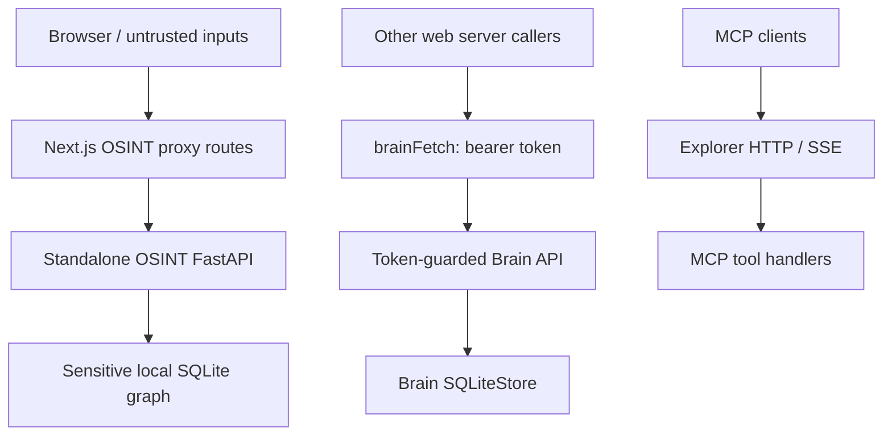

# Security and trust boundaries

This document is a **partial static review** of source boundaries, not an assurance of deployment security. See [detailed findings](technical-audit.md).

## Trust zones

**Important:** A directional connection above is not a claim that every source is exposed publicly.

| Boundary | Source-grounded observation | Review priority |
| --- | --- | --- |
| OSINT backend | Permissive CORS; no auth dependency in inspected sensitive endpoints | High |
| Next.js OSINT proxies | Proxy handlers forward caller JSON without local `requirePrincipal` calls | Medium |
| Brain API | Many routes use `Depends(require_api_token)`; absent configured token is rejected | Positive code control; verification needed |
| Explorer HTTP | Missing `MCP_API_KEY` bypasses auth middleware | Medium |
| Brain filesystem | Workspace containment uses potentially unsafe string prefix comparison | Medium |

Lawful data access, purpose limitation, auditability, retention, isolated deployments, protected secret storage and user authorization should be verified before handling any real personal information.

[Audit evidence](technical-audit.md).
